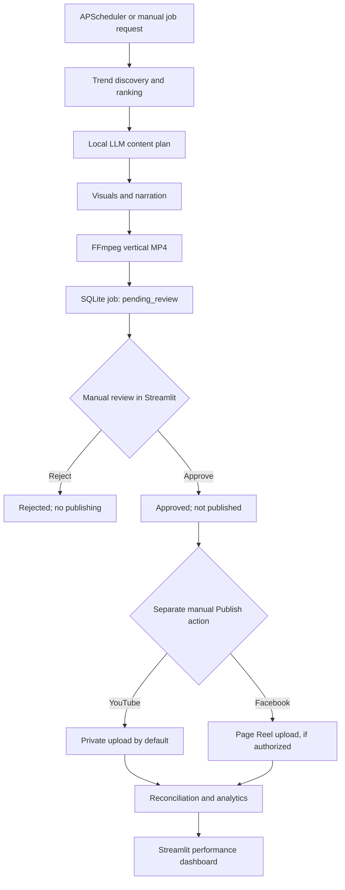

# AI Content Agent

**A local-first, agent-based pipeline for generating, reviewing, and publishing short-form videos.**

AI Content Agent discovers YouTube trends, develops original short-form content plans, generates narration and visual scenes, renders vertical MP4 videos, and presents them for **manual review and manual publishing**. The project runs on an NVIDIA DGX Spark and combines Python services, a LangGraph workflow, FastAPI, SQLite, and a Streamlit dashboard.

> **Current status (November 2026):** Days 1–7 have been implemented in stages. Core services and automated tests are in place, but the complete scheduled-generation-to-publication workflow still requires end-to-end verification. Visual quality is a known limitation: the existing `text` mode creates text-based scenes, while `diffusion` mode depends on local image-model setup. Real stock footage, neural narration, and scene regeneration are planned improvements. Facebook Page authorization is not yet confirmed working.

## Features

- **Trend discovery:** Retrieve popular YouTube videos by region and category; rank candidates using recency, engagement, and view velocity.
- **Content planning:** Use a local Ollama-hosted language model to generate original titles, descriptions, hashtags, narration, and scene-by-scene storyboards.
- **Video rendering:** Generate visual assets, synthesize speech, and combine scenes into vertical MP4 files with FFmpeg. Supports `text` and experimental `diffusion` image modes.
- **Workflow orchestration:** Coordinate trend discovery, content generation, and rendering through LangGraph, with jobs persisted in SQLite.
- **Human approval:** Review generated videos and content plans in Streamlit. Approval and rejection are explicit actions; approval **does not** publish a video.
- **Manual publishing:** Upload approved videos through YouTube and Facebook integrations, subject to configured credentials and platform permissions. YouTube uploads default to `private`.
- **Publication tracking:** Reserve publishing attempts to prevent duplicate uploads, record publication events, and reconcile uncertain outcomes without automatically re-uploading.
- **Analytics:** Collect available YouTube performance metrics, store historical snapshots, and inspect results in a Streamlit dashboard.
- **Scheduling:** Request new generation jobs on a daily schedule using APScheduler. Scheduled generation never invokes approval or publishing.
- **Testing:** Unit tests cover trend ranking, storage, content plans, narration, workflows, publishing safety, analytics, scheduler requests, and review decisions.

## Workflow



**Safety rule:** The scheduler is allowed to create content-generation jobs only. Neither the scheduler nor the generation workflow is authorized to approve or publish content. An approved video still requires a separate manual publishing action.

## Technology stack

| Layer | Technology |
| --- | --- |
| Language | Python 3.12 |
| Orchestration | LangGraph |
| Local language model | Ollama, Qwen3 8B (configurable) |
| API | FastAPI, Uvicorn |
| Storage | SQLite; JSON content plans |
| Image generation | Text-card fallback; optional Stable Diffusion pipeline |
| Narration | `espeak-ng`-based local TTS (current baseline) |
| Video processing | FFmpeg / FFprobe |
| Scheduler | APScheduler 3.x |
| Dashboard | Streamlit, pandas, Plotly |
| Publishing | YouTube Data API, Meta Graph API |
| Analytics | YouTube Data API and YouTube Analytics API |
| Development machine | NVIDIA DGX Spark (ARM64 / NVIDIA GB10) |
| Tests | pytest |

## Project layout

The following is a **representative layout** of the modules introduced through Day 7. Consult the repository itself for the exact current filenames and interfaces.

```text
ai-content-agent/
├── app/
│   ├── agents/
│   │   ├── trend_agent.py
│   │   ├── content_agent.py
│   │   └── video_agent.py
│   ├── api/
│   │   └── routes.py
│   ├── models/
│   │   ├── video.py
│   │   └── content_plan.py
│   ├── services/
│   │   ├── youtube_service.py
│   │   ├── ranking_service.py
│   │   ├── storage_service.py
│   │   ├── llm_service.py
│   │   ├── content_storage.py
│   │   ├── image_service.py
│   │   ├── tts_service.py
│   │   ├── narration_service.py
│   │   ├── video_renderer.py
│   │   ├── job_service.py
│   │   ├── publishing_service.py
│   │   ├── publishing_storage.py
│   │   ├── youtube_publisher.py
│   │   ├── facebook_publisher.py
│   │   ├── youtube_analytics.py
│   │   ├── facebook_analytics.py
│   │   ├── analytics_storage.py
│   │   ├── feedback_service.py
│   │   ├── review_dashboard_service.py
│   │   └── scheduler_service.py
│   └── workflows/
│       └── content_workflow.py
├── pages/
│   ├── 1_Review_Queue.py
│   └── 2_Publishing.py
├── scripts/
│   ├── youtube_auth.py
│   ├── migrate_day6.py
│   ├── reconcile_publications.py
│   └── run_scheduled_job.py
├── tests/
├── data/                        # Generated local data; do not commit secrets
├── credentials/                 # OAuth files; gitignored
├── main.py                      # Trend discovery
├── plan.py                      # Content plan generation
├── render.py                    # Video rendering
├── server.py                    # FastAPI entry point
├── publish.py                   # Manual publishing CLI
├── collect_analytics.py         # Analytics collection
├── dashboard.py                 # Streamlit dashboard
├── scheduler.py                 # Daily generation scheduler
├── requirements.txt
├── .env.example
└── README.md
```

## Prerequisites

- Linux development environment; tested during development on NVIDIA DGX Spark (ARM64).
- Python 3.12 and `venv`.
- FFmpeg and FFprobe.
- `espeak-ng` for baseline narration.
- Ollama with a suitable local model (the development setup used `qwen3:8b`).
- YouTube Data API credentials for trend discovery and YouTube OAuth credentials for publishing.
- Optional: Meta Page access token and Page ID for Facebook Reels.
- Optional: compatible PyTorch, Diffusers, and model weights for image generation.

GPU model compatibility and performance depend on the installed CUDA/PyTorch versions. Image-generation support should be verified on the target machine before enabling unattended jobs.

## Installation

```bash
# Clone your repository (replace YOUR_USERNAME with your GitHub username)
git clone https://github.com/YOUR_USERNAME/ai-content-agent.git
cd ai-content-agent

# Use the main branch
git switch main

# Create and activate a virtual environment
python3 -m venv .venv
source .venv/bin/activate

# Install Python dependencies
python -m pip install --upgrade pip
python -m pip install -r requirements.txt

# Install system tools on Ubuntu / DGX Spark
sudo apt-get update
sudo apt-get install -y ffmpeg espeak-ng sqlite3
```

Install and start Ollama using its official instructions, then pull the configured model:

```bash
ollama pull qwen3:8b
ollama list
```

## Configuration

Create `.env` from the example if present:

```bash
cp .env.example .env
```

Review the existing `.env.example` and application code for exact variable names. The configuration below shows the variables introduced or used during development; not every value is required for every command.

```dotenv
# Core API
CONTENT_API_KEY=replace-with-a-random-secret
CONTENT_REVIEW_API_KEY=replace-with-a-different-secret
CONTENT_PUBLISH_API_KEY=replace-with-another-secret
CONTENT_API_URL=http://127.0.0.1:8000

# Database
DATABASE_PATH=data/trends.db
ANALYTICS_DATABASE_PATH=data/trends.db

# Publishing safety
PUBLISH_DRY_RUN=true
YOUTUBE_PRIVACY_STATUS=private

# YouTube OAuth
YOUTUBE_CLIENT_SECRETS=credentials/youtube_client_secret.json
YOUTUBE_TOKEN_FILE=credentials/youtube_token.json

# Facebook (optional; requires valid Page access)
FACEBOOK_PAGE_ID=
FACEBOOK_PAGE_ACCESS_TOKEN=
META_GRAPH_API_VERSION=v26.0
FACEBOOK_ANALYTICS_ENABLED=false

# Analytics
YOUTUBE_ANALYTICS_ENABLED=true
ANALYTICS_LOOKBACK_DAYS=30

# Scheduler: leave disabled until the end-to-end test passes
SCHEDULER_ENABLED=false
SCHEDULER_TIMEZONE=America/New_York
SCHEDULER_HOUR=9
SCHEDULER_MINUTE=0
SCHEDULER_CATEGORY=science
SCHEDULER_REGION=US
SCHEDULER_VIDEO_LIMIT=5
SCHEDULER_IMAGE_MODE=text
```

The trend-discovery service also requires the YouTube API key expected by your current `youtube_service.py`; set it using the variable name defined in that module. Other model-specific environment variables may be needed by `llm_service.py` and `image_service.py`.

Generate independent API keys with:

```bash
python -c 'import secrets; print(secrets.token_urlsafe(32))'
```

**Never commit** `.env`, `credentials/`, access tokens, OAuth refresh tokens, or generated databases containing private data.

## Usage

Run commands from the repository root with the virtual environment active.

### 1. Discover trends

```bash
python main.py --category science --limit 20
```

This queries YouTube trends, ranks videos, and stores results in SQLite.

### 2. Generate a content plan

```bash
python plan.py --category science --limit 20
```

The content plan includes a title, description, hashtags, hook, narration, and scene descriptions. Plans are persisted in SQLite and as JSON files under `data/plans/`.

### 3. Find a plan ID

```bash
sqlite3 -header -column data/trends.db '
SELECT job_id, plan_id, status, video_path
FROM jobs
WHERE plan_id IS NOT NULL
ORDER BY created_at DESC
LIMIT 10;
'
```

### 4. Render a video

```bash
# Baseline text-card visuals
python render.py --plan-id YOUR_PLAN_ID --image-mode text

# Experimental local image generation
python render.py --plan-id YOUR_PLAN_ID --image-mode diffusion
```

**Known limitation:** `text` mode is a fallback, not a finished visual-content solution. `diffusion` mode requires the model and GPU inference dependencies to work correctly. Neither mode automatically supplies real stock-video footage.

### 5. Start the API

```bash
uvicorn server:app --host 127.0.0.1 --port 8000
```

API documentation is typically available at `http://127.0.0.1:8000/docs`.

The API includes job creation, status, plan/video retrieval, and review endpoints under `/api/v1/jobs`. Publishing endpoints may also be present; check `/docs` for the exact request models and authorization headers in the current version.

### 6. Start the dashboard

```bash
streamlit run dashboard.py \
  --server.address 127.0.0.1 \
  --server.port 8501
```

Open `http://127.0.0.1:8501` locally, or forward port 8501 over SSH when using the DGX remotely.

Dashboard pages:

- **Analytics:** Inspect job counts, publication status, available platform metrics, and historical snapshots.
- **Review Queue:** Preview an MP4, inspect title/description/hashtags and scene narration, then explicitly approve or reject.
- **Publishing:** Select an approved job, choose a platform, perform a dry run, and explicitly authorize a live upload.

Approval changes the job's state to `approved`; **it never starts an upload**.

### 7. Run a generation request manually

With FastAPI running:

```bash
python scripts/run_scheduled_job.py
```

Check its job state:

```bash
sqlite3 -header -column data/trends.db '
SELECT job_id, status, plan_id, video_path
FROM jobs
ORDER BY created_at DESC
LIMIT 10;
'
```

**Integration checkpoint:** Confirm the FastAPI job endpoint starts the existing LangGraph execution path and does not merely insert a queued record. Do not enable scheduled operation until this is verified.

### 8. Enable daily generation

After end-to-end testing, set `SCHEDULER_ENABLED=true` and start:

```bash
python scheduler.py
```

The scheduler requests new generation jobs at the configured local time. It does **not** approve, reject, or publish videos. Run only one scheduler process for the MVP; APScheduler's in-process overlap protection does not coordinate multiple instances.

### 9. Publish manually

After reviewing and approving a job, use the Streamlit Publishing page or the CLI:

```bash
# Dry run (no upload)
python publish.py --job-id YOUR_JOB_ID --platform youtube

# Explicit live upload; YouTube privacy defaults to private
python publish.py --job-id YOUR_JOB_ID --platform youtube --live
```

Facebook publishing requires valid Page credentials and permissions. A successful API upload response is not the same as a verified public publication.

### 10. Reconcile and collect analytics

```bash
python scripts/reconcile_publications.py
python collect_analytics.py
```

Reconciliation checks external status without blindly repeating uploads. Analytics collection stores metrics that the connected APIs make available; unavailable metrics should remain `NULL` rather than being reported as zero.

## Database and state management

SQLite is used for trend records, content plans, generation jobs, publication attempts/events, and analytics snapshots. Typical job states include `pending_review`, `approved`, and `rejected`, alongside workflow-specific processing and failure states. Publication states are tracked separately because a completed upload may still be private, processing, or awaiting reconciliation.

For an existing Day 5 database, the Day 6 migration introduced publication fields such as `attempt_started_at`, `external_status`, and `last_checked_at`, plus the `publication_events` table. The updated `PublishingStorage.initialize()` also adds missing schema elements for new test databases.

Back up the database before applying any future schema changes:

```bash
sqlite3 data/trends.db ".backup 'data/trends_backup.db'"
```

Do not delete `data/trends.db` as a troubleshooting shortcut: it contains job and publication history.

## Testing

```bash
# Full suite
python -m pytest tests/ -v

# Targeted checks
python -m pytest tests/test_publishing.py -v
python -m pytest tests/test_publishing_recovery.py -v
python -m pytest tests/test_scheduler.py -v
python -m pytest tests/test_review_dashboard.py -v
```

The latest shared run had **44 passed and 1 failed**; the remaining failure was traced to an empty `api_key=""` being replaced by `CONTENT_API_KEY` through Python's `or` operator. The recommended correction is to use the environment fallback **only when `api_key is None`**. A full passing run after that change has not yet been confirmed in the conversation.

Tests use mocks for platform services and cannot prove that live OAuth, Meta permissions, scheduled workflow execution, GPU image generation, or remote platform publishing work end to end.

## Development progress

| Day | Focus | Current state |
| --- | --- | --- |
| 1 | YouTube discovery, ranking, SQLite | Implemented |
| 2 | Ollama content plans and storyboard validation | Implemented |
| 3 | Images, narration, FFmpeg MP4 rendering | Implemented; visual quality needs improvement |
| 4 | LangGraph workflow, FastAPI, persistent jobs, review | Implemented; integration should be rechecked |
| 5 | YouTube OAuth and Facebook Reels publishing | Implemented; Facebook authorization unresolved |
| 6 | Analytics snapshots, dashboard, duplicate protection, reconciliation | Implemented; live platform checks still needed |
| 7 | APScheduler, Streamlit review queue, manual publishing page | Implementation added; end-to-end verification pending |

## Known issues and planned improvements

1. **Visual quality:** Current text-card output does not meet the target quality for YouTube Shorts or Facebook Reels. Add a visual-asset pipeline with licensed stock footage, better image models, and explicit scene-level asset checks.
2. **Narration:** Replace baseline `espeak-ng` with a more natural local neural TTS model; add synchronized word-level subtitles.
3. **Editing:** Add motion to still images, transitions, caption timing, audio mixing, and scene-quality checks before review.
4. **Content research:** Improve factual grounding, originality, scene relevance, and topic selection. Review source licenses before reuse.
5. **Review workflow:** Add controlled **Regenerate Script**, **Regenerate Images**, **Regenerate Narration**, and **Re-render Video** actions. Retain manual approval and publishing.
6. **Facebook permissions:** Resolve the Page ID / Page access token / Graph API permissions before relying on Facebook publishing or analytics.
7. **Scheduler reliability:** Verify that the API request starts actual generation; prevent overlapping long-running jobs; distinguish safe generation retries from uncertain publication outcomes.
8. **Deployment:** Consider `systemd` services and health checks after single-machine end-to-end tests pass. Keep the dashboard bound to localhost or behind authenticated access.

## Security and content policy

- **Manual review is mandatory.** Automatically generated material must not be automatically published.
- **Separate privileges.** Generation, review, and publishing use separate API credentials where supported.
- **No duplicate blind uploads.** If a platform upload's outcome is uncertain, reconcile it before authorizing a new attempt.
- **Private by default.** YouTube uploads default to `private` until manually changed through the platform's controls.
- **Review claims and licenses.** Verify factual claims, visual/audio licensing, and the intended audience before publishing. Do not reuse third-party YouTube footage without permission.
- **Protect credentials.** Do not expose `.env`, OAuth files, SQLite databases, or the Streamlit dashboard publicly.

## Git workflow

Development uses the **`main` branch only**:

```bash
git branch --show-current
git status
git add README.md
git diff --cached --check
git commit -m "docs: document AI Content Agent through Day 7"
git push origin main
```

## Project direction

The next development stage focuses on **content quality**, not additional publishing automation: better scene assets, natural narration, source-aware scripting, and regeneration controls inside the manual review dashboard. The intended workflow remains **automated creation → manual review → manual publishing → analytics**.
