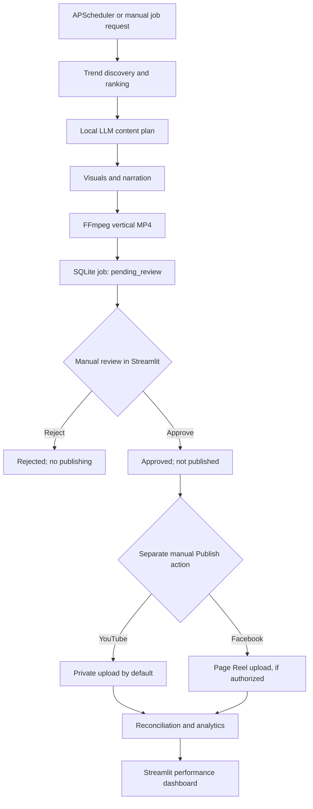

# AI Content Agent

**A local-first, agent-based pipeline for generating, reviewing, and publishing short-form videos.**

AI Content Agent discovers YouTube trends, develops original short-form content plans, generates narration and visual scenes, renders vertical MP4 videos, and presents them for **manual review and manual publishing**. The project runs on an NVIDIA DGX Spark and combines Python services, a LangGraph workflow, FastAPI, SQLite, and a Streamlit dashboard.

The primary interface is now a local **React Content Studio** served by FastAPI. One administrator signs in with a username and password; browser review and publishing do not require entering API keys. The existing Streamlit pages and command-line tools remain available.

## Web dashboard and admin login

Use Python 3.12 and Node.js 22.12+ (Node 22 LTS is suitable). From the repository root with the Python virtual environment active:

```bash
# One-time local account setup. Password entry is hidden; minimum 12 characters.
python scripts/setup_admin.py --username admin

# Install the locked frontend dependencies and build the dashboard.
cd frontend
npm ci
npm run build
cd ..

# Serve both UI and API from the same local address.
uvicorn server:app --host 127.0.0.1 --port 8000
```

Open **http://127.0.0.1:8000** and sign in. For a remote DGX, forward port 8000 over SSH and open the forwarded localhost URL. Node is only needed to develop/build the frontend; the built dashboard is served by Python. Rebuild after changing frontend source.

- **Overview:** actual job counts, recent content, publication status, and latest collected analytics. Empty states are shown when no data exists.
- **Review Queue:** authenticated video playback, scene images, script/storyboard, available provenance, and an explicit review checklist. Approval and rejection only update review state.
- **Publishing:** approved videos, destination selection, dry-run validation by default, a separate live-upload confirmation, and publication history. Any existing job/platform attempt blocks another upload; uncertain outcomes require reconciliation.

There is exactly one locally configured admin account, with no public registration or web password-reset endpoint. To replace its credentials and revoke all sessions, run `python scripts/setup_admin.py --username admin --reset`. Credentials are scrypt-hashed in the gitignored `credentials/admin.json`, written with owner-only permissions. Session tokens are random and stored hashed in additive SQLite auth tables. Browser cookies are HttpOnly, SameSite=Strict, expire after 12 hours by default, and use Secure over HTTPS. Failed sign-ins are throttled. State-changing browser requests require a session-bound CSRF token; the UI handles it automatically.

Optional settings: `ADMIN_CREDENTIALS_FILE`, `ADMIN_SESSION_HOURS` (1–168), `ADMIN_COOKIE_SECURE=true` when using HTTPS, and `CONTENT_PLANS_DIR`. Keep the service bound to localhost. No admin password or session token is included in the frontend build, URLs, or browser storage.

For frontend development, run the API as above and `npm run dev` inside `frontend/`; Vite binds to 127.0.0.1 and proxies `/api` to the local API. Run frontend checks with `npm test` and `npm run build`. Production does not need the Vite server.

Existing scheduler requests still use `CONTENT_API_KEY`. Manual API review now requires `X-Review-Key: CONTENT_REVIEW_API_KEY`; publishing requires `X-Publish-Key: CONTENT_PUBLISH_API_KEY`, or an authenticated browser session with CSRF protection. A generation key alone cannot approve or publish. Browser live publishing additionally requires `confirmed: true`; dry runs remain the default. No publishing endpoint is called by approval.

YouTube resumable uploads continue through acknowledged chunks, but failed chunk requests are not automatically retried, including HTTP 5xx responses. The existing reservation remains for reconciliation; a new upload attempt requires human intervention.

> **Current status (November 2026):** Days 1–7 have been implemented in stages. Core services and automated tests are in place, but the complete scheduled-generation-to-publication workflow still requires end-to-end verification. Visual quality is a known limitation: the existing `text` mode creates text-based scenes, while `diffusion` mode depends on local image-model setup. Cloud moving footage, model audio and versioned shot regeneration are now implemented as described above; local stock acquisition and neural local narration remain future work. Facebook Page authorization is not yet confirmed working.

## OpenAI planning, Gemini video and local assembly — Phases 1–4 and 6

The local React studio and Streamlit **Create Video** page now share the provider, script, character-reference and video-production APIs. Kling and Phase 5 are retired at the user's request; old stored selections remain readable and cannot execute. Local models remain an explicit option. A cloud failure never silently selects local models or text cards.

| Stage | Implementation |
| --- | --- |
| Script / characters / scene and camera planning | OpenAI `gpt-6.1-sol` with strict structured output; local Ollama remains selectable |
| Realistic / animated moving footage | Google `gemini-omni-1.1-flash`, one tracked request per planned shot |
| Shot edits / extensions | Gemini conversational edits and extensions using the prior interaction ID; candidates preserve the original |
| Final assembly | Local FFmpeg on DGX Spark: trim, normalize, captions, audio, MP4 validation |
| Local fallback | Existing Ollama, text/diffusion scenes, local narration and renderer; select it explicitly |

Current cloud productions are **30–60 seconds**, up to **12 shots**, with individual initial shots of **3–10 seconds**, at **24 fps** and **9:16 or 16:9**. Native generation is 720p; selecting 1080p upscales locally. Long drama remains visible but unimplemented. News remains an **unverified draft** with AI illustrative scenes; there is no automated fact checker or licensed stock-footage integration. Local previews keep their previous aspect-ratio/resolution/frame-rate behavior, including legacy requests and existing jobs.

### Start a cloud production

Set these credentials privately in `.env`, then restart FastAPI. Never enter them into the dashboard:

```dotenv
OPENAI_API_KEY=
GEMINI_API_KEY=
```

Rebuild the React app after source updates using `cd frontend && npm run build`. No new Python dependencies, CUDA packages, model weights or GPU downloads are needed. Use the existing single admin login; browser generation/review/publishing does not ask for API keys.

1. In **Create video**, choose the content type/style/duration, **OpenAI** script provider and **Google Gemini** video provider. Choose 24 fps. Drama/animated character dialogue requires **Gemini model audio**; local TTS is a single narrator. Timed captions use phrase timings described below.
2. In **Script workshop**, explicitly check model access/estimate the script cost, authorize one request, then generate. The validated draft includes original narration, fictional character IDs/descriptions, dialogue, and camera/action shots whose durations cover each scene. A revision creates a separate draft and preserves the original.
3. In **Gemini video production**, refresh history and select the completed script. Upload original/permitted reference images to the local registry, using the exact character IDs from the script. Select one reference for every character in drama/animation; up to three are supported. Realistic non-character footage may omit references.
4. Estimate video cost, inspect the script/reference selection and quote, then explicitly confirm. The existing draft is reused; video creation does not bill a second script request. Each shot is submitted once, its interaction ID is recorded, and completed clips are downloaded and validated. React retrieves progress automatically; Streamlit uses **Refresh production history**.
5. Inspect selected clips and the final MP4. Confirm appearance/clothing/actions/voices, caption/audio timing, factual labeling and media rights, then **Send video to manual review**. Only technically valid, complete footage can reach this step. This does not approve the video.
6. In **Review Queue**, approve/reject explicitly. An approved video still requires a separate manual action in **Publishing**; dry run/private defaults and duplicate-upload reconciliation are preserved.

The completed script's generation settings are immutable. To change its content type/duration/audio/output configuration, create a revised script with the desired settings; uploading/selecting references afterward is supported. Local video requests still use the existing `/jobs` path. Cloud jobs reuse the LangGraph execution path with discovery and paid planning skipped because their completed draft and shot authorizations are already persisted.

### References, regeneration, edits and extensions

The registry stores character identity, appearance, clothing, voice notes, source/rights notes and image hashes. Images require a permission confirmation, at least 128px, at most 16 megapixels and 4MB. They are normalized to an owner-readable PNG of at most 2MB with metadata stripped. Files are under gitignored `data/character_references/` by default. Reference images stay local until selected for an explicitly authorized Google request. Reference IDs must match the draft's character IDs; identity and voice consistency are **not guaranteed** by that check or by the model.

Each shot has immutable version history and separate cost authorization. **Regenerate**, **Edit**, and **Extend** create candidates; they do not overwrite selected clips. Preview a candidate, choose a trim start, then **Use this shot & assemble**. Choosing a version invalidates previous quality checks. Approved/rejected jobs and jobs with publication attempts are locked against production changes.

Extensions add 3–10 seconds to a generated candidate, up to 40 seconds. They use the previous generated interaction, not arbitrary uploaded video. Google does not clearly specify whether every extension returns a full candidate or only a continuation; the application requires the measured full requested candidate duration and rejects incompatible output instead of blindly concatenating it. The original remains available. A trim window selects footage for the original planned shot duration; extension does not automatically lengthen the screenplay. Voice editing and uploaded audio references are unsupported.

### Costs, storage and recovery

Quotes last ten minutes, bind the administrator and exact request/references, require strict boolean confirmation and can be consumed only once. Saving settings or a `paid_generation_confirmed` field never authorizes a charge. Scheduler generation keys cannot authorize cloud work.

The OpenAI estimator retains the conservative $0.21 script token bound with 60,000 UTF-8 request bytes and 8,000 output tokens. Google pricing checked November 3, 2026 is $1.50/M input, $9/M text output and $17.50/M video output tokens. The documented 720p conversion of 5,792 video tokens/second gives about **$3.04 for 30s / $6.08 for 60s** of video output before input/thinking costs. The application estimates each initial request using the maximum 10-second clip allowance plus input/thinking allowances; extensions reserve the full candidate duration. Estimates include prior reserved shot estimates and the script authorization when available, and reject projected estimated spend beyond the configured budget. These are **estimates, not guaranteed invoice caps**. Provider billing remains authoritative. [Google pricing](https://aistudio.google.com/docs/pricing#gemini-omni-1.1-flash)

Usage records keep numeric token counts and external interaction IDs. A calculated standard-price estimate is shown only when complete, consistent modality and separate thinking counts are present; actual invoiced cost stays unknown. Cached billing adjustments and other provider/account adjustments are not asserted. [Google token usage](https://aistudio.google.com/docs/tokens)

Paid POSTs have no automatic retries, redirects, model substitution or local fallback. A timeout/ambiguous result becomes `needs_reconciliation`. A known interaction can be retrieved/downloaded without a new generation request. Inspect provider usage and record reconciliation notes; if an interaction ID was found, attach it explicitly for retrieval. An inspected attempt may be closed locally without cancelling/refunding the provider request. A new paid candidate needs a new quote and preserves the old consumed authorization. After an interrupted batch, **Continue unsubmitted authorized shots** requires confirmation and submits only previously reserved shots that never crossed the submission boundary. It does not repeat an uncertain POST. **Discard never-submitted shots** releases only queued reservations without a provider call; submitted and uncertain interactions remain in history for inspection.

SQLite initialization adds production, quote, shot-version, event, processing-lease and reference tables idempotently. Existing jobs/plans/auth/publication history is preserved. Back up the database before upgrading. Background tasks are in-process with per-production leases; browser/server restarts may require explicit status refresh or reconciliation. There is no durable worker queue. Assets default to gitignored `data/videos/cloud/`; optional `CLOUD_VIDEOS_DIR` and `CHARACTER_REFERENCES_DIR` choose local paths. Never commit those files or databases.

Google background Interactions use `store:true`, with paid interactions retained for up to 55 days by default. Account access, quotas, background availability and retention requirements must be checked in your project. The model guide documents native video; the background guide documents the general async contract, without an Omni-specific example. **No real paid account call was used in implementation verification.** [Video guide](https://aistudio.google.com/docs/omni), [background execution](https://aistudio.google.com/docs/background-execution).

### Media quality and current limits

Every raw selected clip must decode, match planned duration, contain measurable motion and include audio when requested. Missing/invalid assets block review. FFmpeg normalizes geometry/frame rate, handles explicit trim windows, adds model audio or local narration, renders readable captions, normalizes loudness and validates the complete H.264/AAC MP4. Captions use **estimated phrase timing**, not speech recognition/forced alignment; human synchronization checks remain mandatory. Technical motion checks do not establish acting quality, correct speech, factual accuracy or identity continuity.

Neural local TTS, automatic word-aligned captions, automated semantic continuity checks, durable workers, verified news research, licensed stock acquisition, arbitrary uploaded-video editing and 5–20-minute productions remain future work. The existing local TTS/image pipeline is preserved without claiming a quality upgrade to its models.

### API additions

All cloud endpoints require the existing admin session; mutations require CSRF. No cloud endpoint approves or publishes content.

| Endpoint under `/api/v1/generation` | Purpose |
| --- | --- |
| `catalog`, `preflight`, `configurations` | Provider metadata, validation, saved settings |
| `openai-models`, `script-quotes`, `scripts` | Explicit script access/cost checks, draft generation/history |
| `references`, `references/{id}/image` | Local rights-confirmed reference upload/list and authenticated images |
| `POST video-quotes` | Estimate a completed draft's shots and selected references |
| `POST videos`, `GET videos`, `GET videos/{id}` | Explicit creation and production history/status |
| `POST videos/{id}/refresh` | Background retrieval/download/local assembly; never a paid submission |
| `POST videos/{id}/shot-quotes`, `POST videos/{id}/shots` | Quote/confirm one regenerated, edited or extended candidate |
| `POST videos/{id}/select` | Explicit candidate/trim selection and local reassembly |
| `POST videos/{id}/shots/{attempt}/reconcile` | Human inspection notes, optional remote ID or local close |
| `POST videos/{id}/continue` | Confirm previously authorized, never-submitted queued shots |
| `POST videos/{id}/discard-queued` | Discard never-submitted reservations without a provider call |
| `POST videos/{id}/review` | Human quality-check handoff to `pending_review`; no approval/publication |

The OpenAI adapter uses [Responses](https://developers.openai.com/api/reference/resources/responses/methods/create) and [strict structured output](https://developers.openai.com/api/docs/guides/structured-outputs) with `gpt-6.1-sol`; `gpt-6-sol` remains an explicit alternative. It never silently changes models. Google uses the documented REST `steps[].content[]` video response, authenticated downloads, and `previous_interaction_id` for edits/extensions. Undefined duration-string syntax is not invented: duration is requested in the prompt and measured locally, so a model duration mismatch fails visibly rather than passing a bad clip.

## Features

- **Trend discovery:** Retrieve popular YouTube videos by region and category; rank candidates using recency, engagement, and view velocity.
- **Content planning:** Use a local Ollama-hosted language model to generate original titles, descriptions, hashtags, narration, and scene-by-scene storyboards.
- **Video rendering:** Generate visual assets, synthesize speech, and combine scenes into vertical MP4 files with FFmpeg. Supports `text` and experimental `diffusion` image modes.
- **Workflow orchestration:** Coordinate trend discovery, content generation, and rendering through LangGraph, with jobs persisted in SQLite.
- **Human approval:** Review generated videos and content plans in Streamlit. Approval and rejection are explicit actions; approval **does not** publish a video.
- **Manual publishing:** Upload approved videos through YouTube and Facebook integrations, subject to configured credentials and platform permissions. YouTube uploads default to `private`.
- **Publication tracking:** Reserve publishing attempts to prevent duplicate uploads, record publication events, and reconcile uncertain outcomes without automatically re-uploading.
- **Analytics:** Collect available YouTube performance metrics, store historical snapshots, and inspect results in a Streamlit dashboard.
- **Scheduling:** Request new generation jobs on a daily schedule using APScheduler. Scheduled generation never invokes approval or publishing.
- **Testing:** Unit tests cover trend ranking, storage, content plans, narration, workflows, publishing safety, analytics, scheduler requests, and review decisions.

## Workflow



**Safety rule:** The scheduler is allowed to create content-generation jobs only. Neither the scheduler nor the generation workflow is authorized to approve or publish content. An approved video still requires a separate manual publishing action.

## Technology stack

| Layer | Technology |
| --- | --- |
| Language | Python 3.12 |
| Orchestration | LangGraph |
| Local language model | Ollama, Qwen3 8B (configurable) |
| API | FastAPI, Uvicorn |
| Storage | SQLite; JSON content plans |
| Image generation | Text-card fallback; optional Stable Diffusion pipeline |
| Narration | `espeak-ng`-based local TTS (current baseline) |
| Video processing | FFmpeg / FFprobe |
| Scheduler | APScheduler 3.x |
| Dashboard | Streamlit, pandas, Plotly |
| Web dashboard | React, Vite; served by FastAPI with single-admin sessions |
| Publishing | YouTube Data API, Meta Graph API |
| Analytics | YouTube Data API and YouTube Analytics API |
| Development machine | NVIDIA DGX Spark (ARM64 / NVIDIA GB10) |
| Tests | pytest |

## Project layout

The following is a **representative layout** of the modules introduced through Day 7. Consult the repository itself for the exact current filenames and interfaces.

```text
ai-content-agent/
├── app/
│   ├── agents/
│   │   ├── trend_agent.py
│   │   ├── content_agent.py
│   │   └── video_agent.py
│   ├── api/
│   │   └── routes.py
│   ├── models/
│   │   ├── video.py
│   │   └── content_plan.py
│   ├── services/
│   │   ├── youtube_service.py
│   │   ├── ranking_service.py
│   │   ├── storage_service.py
│   │   ├── llm_service.py
│   │   ├── content_storage.py
│   │   ├── image_service.py
│   │   ├── tts_service.py
│   │   ├── narration_service.py
│   │   ├── video_renderer.py
│   │   ├── job_service.py
│   │   ├── publishing_service.py
│   │   ├── publishing_storage.py
│   │   ├── youtube_publisher.py
│   │   ├── facebook_publisher.py
│   │   ├── youtube_analytics.py
│   │   ├── facebook_analytics.py
│   │   ├── analytics_storage.py
│   │   ├── feedback_service.py
│   │   ├── review_dashboard_service.py
│   │   └── scheduler_service.py
│   └── workflows/
│       └── content_workflow.py
├── pages/
│   ├── 1_Review_Queue.py
│   └── 2_Publishing.py
├── frontend/                    # React studio; npm ci && npm run build
├── scripts/
│   ├── youtube_auth.py
│   ├── migrate_day6.py
│   ├── reconcile_publications.py
│   ├── run_scheduled_job.py
│   └── setup_admin.py            # Local-only account setup/reset
├── tests/
├── data/                        # Generated local data; do not commit secrets
├── credentials/                 # OAuth files; gitignored
├── main.py                      # Trend discovery
├── plan.py                      # Content plan generation
├── render.py                    # Video rendering
├── server.py                    # FastAPI entry point
├── publish.py                   # Manual publishing CLI
├── collect_analytics.py         # Analytics collection
├── dashboard.py                 # Streamlit dashboard
├── scheduler.py                 # Daily generation scheduler
├── requirements.txt
├── .env.example
└── README.md
```

## Prerequisites

- Linux development environment; tested during development on NVIDIA DGX Spark (ARM64).
- Python 3.12 and `venv`.
- FFmpeg and FFprobe.
- `espeak-ng` for baseline narration.
- Ollama with a suitable local model (the development setup used `qwen3:8b`).
- YouTube Data API credentials for trend discovery and YouTube OAuth credentials for publishing.
- Optional: Meta Page access token and Page ID for Facebook Reels.
- Optional: compatible PyTorch, Diffusers, and model weights for image generation.

GPU model compatibility and performance depend on the installed CUDA/PyTorch versions. Image-generation support should be verified on the target machine before enabling unattended jobs.

## Installation

```bash
# Clone your repository (replace YOUR_USERNAME with your GitHub username)
git clone https://github.com/YOUR_USERNAME/ai-content-agent.git
cd ai-content-agent

# Use the main branch
git switch main

# Create and activate a virtual environment
python3 -m venv .venv
source .venv/bin/activate

# Install Python dependencies
python -m pip install --upgrade pip
python -m pip install -r requirements.txt

# Install system tools on Ubuntu / DGX Spark
sudo apt-get update
sudo apt-get install -y ffmpeg espeak-ng sqlite3
```

Install and start Ollama using its official instructions, then pull the configured model:

```bash
ollama pull qwen3:8b
ollama list
```

## Configuration

Create `.env` from the example if present:

```bash
cp .env.example .env
```

Review the existing `.env.example` and application code for exact variable names. The configuration below shows the variables introduced or used during development; not every value is required for every command.

```dotenv
# Core API
CONTENT_API_KEY=replace-with-a-random-secret
CONTENT_REVIEW_API_KEY=replace-with-a-different-secret
CONTENT_PUBLISH_API_KEY=replace-with-another-secret
CONTENT_API_URL=http://127.0.0.1:8000

# Database
DATABASE_PATH=data/trends.db
ANALYTICS_DATABASE_PATH=data/trends.db

# Publishing safety
PUBLISH_DRY_RUN=true
YOUTUBE_PRIVACY_STATUS=private

# YouTube OAuth
YOUTUBE_CLIENT_SECRETS=credentials/youtube_client_secret.json
YOUTUBE_TOKEN_FILE=credentials/youtube_token.json

# Facebook (optional; requires valid Page access)
FACEBOOK_PAGE_ID=
FACEBOOK_PAGE_ACCESS_TOKEN=
META_GRAPH_API_VERSION=v26.0
FACEBOOK_ANALYTICS_ENABLED=false

# Analytics
YOUTUBE_ANALYTICS_ENABLED=true
ANALYTICS_LOOKBACK_DAYS=30

# Scheduler: leave disabled until the end-to-end test passes
SCHEDULER_ENABLED=false
SCHEDULER_TIMEZONE=America/New_York
SCHEDULER_HOUR=9
SCHEDULER_MINUTE=0
SCHEDULER_CATEGORY=science
SCHEDULER_REGION=US
SCHEDULER_VIDEO_LIMIT=5
SCHEDULER_IMAGE_MODE=text
```

The trend-discovery service also requires the YouTube API key expected by your current `youtube_service.py`; set it using the variable name defined in that module. Other model-specific environment variables may be needed by `llm_service.py` and `image_service.py`.

Generate independent API keys with:

```bash
python -c 'import secrets; print(secrets.token_urlsafe(32))'
```

**Never commit** `.env`, `credentials/`, access tokens, OAuth refresh tokens, or generated databases containing private data.

## Usage

Run commands from the repository root with the virtual environment active.

### 1. Discover trends

```bash
python main.py --category science --limit 20
```

This queries YouTube trends, ranks videos, and stores results in SQLite.

### 2. Generate a content plan

```bash
python plan.py --category science --limit 20
```

The content plan includes a title, description, hashtags, hook, narration, and scene descriptions. Plans are persisted in SQLite and as JSON files under `data/plans/`.

### 3. Find a plan ID

```bash
sqlite3 -header -column data/trends.db '
SELECT job_id, plan_id, status, video_path
FROM jobs
WHERE plan_id IS NOT NULL
ORDER BY created_at DESC
LIMIT 10;
'
```

### 4. Render a video

```bash
# Baseline text-card visuals
python render.py --plan-id YOUR_PLAN_ID --image-mode text

# Experimental local image generation
python render.py --plan-id YOUR_PLAN_ID --image-mode diffusion
```

**Known limitation:** `text` mode is a fallback, not a finished visual-content solution. `diffusion` mode requires the model and GPU inference dependencies to work correctly. Neither mode automatically supplies real stock-video footage.

### 5. Start the API

```bash
uvicorn server:app --host 127.0.0.1 --port 8000
```

API documentation is typically available at `http://127.0.0.1:8000/docs`.

The API includes job creation, status, plan/video retrieval, and review endpoints under `/api/v1/jobs`. Publishing endpoints may also be present; check `/docs` for the exact request models and authorization headers in the current version.

### 6. Start the dashboard

```bash
streamlit run dashboard.py \
  --server.address 127.0.0.1 \
  --server.port 8501
```

Open `http://127.0.0.1:8501` locally, or forward port 8501 over SSH when using the DGX remotely.

Dashboard pages:

- **Analytics:** Inspect job counts, publication status, available platform metrics, and historical snapshots.
- **Review Queue:** Preview an MP4, inspect title/description/hashtags and scene narration, then explicitly approve or reject.
- **Publishing:** Select an approved job, choose a platform, perform a dry run, and explicitly authorize a live upload.

Approval changes the job's state to `approved`; **it never starts an upload**.

### 7. Run a generation request manually

With FastAPI running:

```bash
python scripts/run_scheduled_job.py
```

Check its job state:

```bash
sqlite3 -header -column data/trends.db '
SELECT job_id, status, plan_id, video_path
FROM jobs
ORDER BY created_at DESC
LIMIT 10;
'
```

**Integration checkpoint:** Confirm the FastAPI job endpoint starts the existing LangGraph execution path and does not merely insert a queued record. Do not enable scheduled operation until this is verified.

### 8. Enable daily generation

After end-to-end testing, set `SCHEDULER_ENABLED=true` and start:

```bash
python scheduler.py
```

The scheduler requests new generation jobs at the configured local time. It does **not** approve, reject, or publish videos. Run only one scheduler process for the MVP; APScheduler's in-process overlap protection does not coordinate multiple instances.

### 9. Publish manually

After reviewing and approving a job, use the Streamlit Publishing page or the CLI:

```bash
# Dry run (no upload)
python publish.py --job-id YOUR_JOB_ID --platform youtube

# Explicit live upload; YouTube privacy defaults to private
python publish.py --job-id YOUR_JOB_ID --platform youtube --live
```

Facebook publishing requires valid Page credentials and permissions. A successful API upload response is not the same as a verified public publication.

### 10. Reconcile and collect analytics

```bash
python scripts/reconcile_publications.py
python collect_analytics.py
```

Reconciliation checks external status without blindly repeating uploads. Analytics collection stores metrics that the connected APIs make available; unavailable metrics should remain `NULL` rather than being reported as zero.

## Database and state management

SQLite is used for trend records, content plans, generation jobs, publication attempts/events, and analytics snapshots. Typical job states include `pending_review`, `approved`, and `rejected`, alongside workflow-specific processing and failure states. Publication states are tracked separately because a completed upload may still be private, processing, or awaiting reconciliation.

For an existing Day 5 database, the Day 6 migration introduced publication fields such as `attempt_started_at`, `external_status`, and `last_checked_at`, plus the `publication_events` table. The updated `PublishingStorage.initialize()` also adds missing schema elements for new test databases.

Back up the database before applying any future schema changes:

```bash
sqlite3 data/trends.db ".backup 'data/trends_backup.db'"
```

Do not delete `data/trends.db` as a troubleshooting shortcut: it contains job and publication history.

## Testing

```bash
# Full suite
python -m pytest tests/ -v

# Targeted checks
python -m pytest tests/test_publishing.py -v
python -m pytest tests/test_publishing_recovery.py -v
python -m pytest tests/test_scheduler.py -v
python -m pytest tests/test_review_dashboard.py -v
```

The pre-dashboard audit baseline was **45 passed**. The empty scheduler-key fallback is already fixed. New admin/dashboard tests cover authentication, CSRF, cookie-protected video playback, manual approval, publishing confirmation, duplicate prevention, and uncertain upload reconciliation. All tests use temporary credentials/databases and mock external uploads. Run the full suite for the current result.

Original dashboard implementation verification: **124 Python tests and 8 frontend tests passed**; production frontend build passed; npm dependency audit reported zero advisories. Headless Chrome checks used a temporary SQLite database and synthetic local media to verify desktop/mobile login, decoded video playback, scene previews, approval without publishing, dry-run validation, cancellation of live confirmation, navigation, and logout. No live platform upload was tested.

Tests use mocks for platform services and cannot prove that live OAuth, Meta permissions, scheduled workflow execution, GPU image generation, or remote platform publishing work end to end.

## Development progress

| Day | Focus | Current state |
| --- | --- | --- |
| 1 | YouTube discovery, ranking, SQLite | Implemented |
| 2 | Ollama content plans and storyboard validation | Implemented |
| 3 | Images, narration, FFmpeg MP4 rendering | Implemented; visual quality needs improvement |
| 4 | LangGraph workflow, FastAPI, persistent jobs, review | Implemented; integration should be rechecked |
| 5 | YouTube OAuth and Facebook Reels publishing | Implemented; Facebook authorization unresolved |
| 6 | Analytics snapshots, dashboard, duplicate protection, reconciliation | Implemented; live platform checks still needed |
| 7 | APScheduler, Streamlit review queue, manual publishing page | Implementation added; end-to-end verification pending |

## Known issues and planned improvements

1. **Visual quality:** Local text cards remain a baseline. Gemini moving-clip generation and explicit asset checks are implemented; live model quality still needs manual verification. Licensed stock acquisition and improved local image models remain future work.
2. **Narration:** Gemini model audio is selectable for cloud footage; local `espeak-ng` remains the baseline. Natural local neural TTS and forced word-aligned subtitles remain future work.
3. **Editing:** Cloud clip normalization, trims, Gemini edit/extension candidates, phrase captions, loudness normalization and technical checks are implemented. Exact speech alignment and semantic quality assessment still require human review.
4. **Content research:** Improve factual grounding, originality, scene relevance, and topic selection. Review source licenses before reuse.
5. **Review workflow:** Add controlled **Regenerate Script**, **Regenerate Images**, **Regenerate Narration**, and **Re-render Video** actions. Retain manual approval and publishing.
6. **Facebook permissions:** Resolve the Page ID / Page access token / Graph API permissions before relying on Facebook publishing or analytics.
7. **Scheduler reliability:** Verify that the API request starts actual generation; prevent overlapping long-running jobs; distinguish safe generation retries from uncertain publication outcomes.
8. **Deployment:** Consider `systemd` services and health checks after single-machine end-to-end tests pass. Keep the dashboard bound to localhost or behind authenticated access.

## Security and content policy

- **Manual review is mandatory.** Automatically generated material must not be automatically published.
- **Separate privileges.** Generation, review, and publishing use separate API credentials where supported.
- **No duplicate blind uploads.** If a platform upload's outcome is uncertain, reconcile it before authorizing a new attempt.
- **Private by default.** YouTube uploads default to `private` until manually changed through the platform's controls.
- **Review claims and licenses.** Verify factual claims, visual/audio licensing, and the intended audience before publishing. Do not reuse third-party YouTube footage without permission.
- **Protect credentials.** Do not expose `.env`, OAuth files, SQLite databases, or the Streamlit dashboard publicly.

## Git workflow

Development uses the **`main` branch only**:

```bash
git branch --show-current
git status
git add README.md
git diff --cached --check
git commit -m "docs: document AI Content Agent through Day 7"
git push origin main
```

## Project direction

The next development stage focuses on **content quality**, not additional publishing automation: better scene assets, natural narration, source-aware scripting, and regeneration controls inside the manual review dashboard. The intended workflow remains **automated creation → manual review → manual publishing → analytics**.

Phase 2 verification: **303 Python tests passed**, including fresh/existing SQLite migrations, strict script validation, cost authorization, uncertain requests, local supplied-source planning, API authorization and Streamlit interactions. **22 frontend tests passed** and the production build passed. Chrome fixture checks verified a mocked OpenAI script submission, desktop/mobile layouts, decoded video playback, manual approval without publication, publishing dry run and live-confirmation cancellation. Paid providers and uploads were mocked; a Phase 1 test rendered and decoded actual temporary FFmpeg/espeak output. These checks do not establish live model availability or improved image/TTS quality.


Phases 3/4/6 verification on Linux ARM64 (`aarch64`), Python 3.12.3: **337 Python tests passed**, **27 frontend tests passed**, production build passed, and `git diff --check` passed. Checks cover fresh/existing SQLite migration, structured shots and references, cost confirmation/quote consumption, concurrent duplicate-POST prevention, ambiguous outcomes, safe retrieval and local closure, queued-shot discard/continuation, version preservation and trim selection, usage/thinking cost estimates, manual quality/review/publishing boundaries, actual 30-second FFmpeg caption/audio assembly and complete decoding. Chrome fixture QA also exercised a five-shot mocked-provider production through real local FFmpeg assembly, desktop/mobile playback, quality-check handoff, manual approval without publication, publishing dry run and cancellation. No paid calls, uploads, model downloads, public deployments or commits were performed. Live Gemini account access, background behavior, duration adherence, extension semantics and output quality remain unverified; all provider success responses in tests were mocked.
