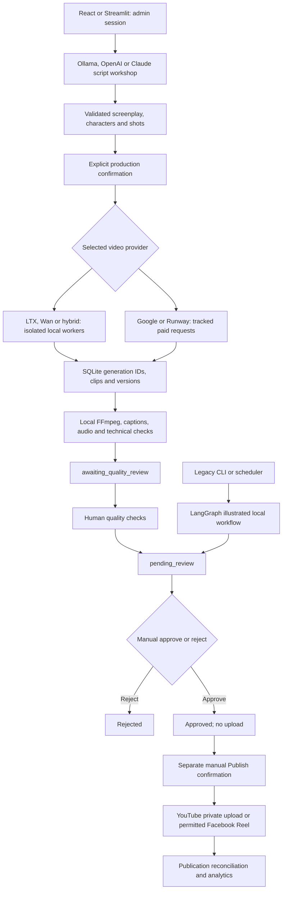

# AI Content Agent

## Daily automation foundation — 2026-11-06

Phase 1 of the opt-in automation layer adds validated lane configuration, an
injectable Clock, additive SQLite schema, append-only audit events, persistent
idempotency helpers and a planning-only Lane/Director skeleton. No automation runs
on startup; existing creation, review, publishing, APIs and dashboards are unchanged.
Five daily Shorts and a 30-day series of 5–10-minute episodes are configuration
targets, **not yet implemented daily production**. Lane C ships disabled.

```bash
# Offline inspection: no database writes, providers, GPU work or services.
.venv/bin/python -m app.automation --config config/lanes.yaml --describe
.venv/bin/python -m pytest tests/test_automation_foundation.py -q
```

Director/Governor default disabled, lane approval modes default manual, and future
Governor dry-run defaults true. No live-database migration is applied in this phase.
Phase 1 verification: **675 Python tests passed** (baseline 623), **66 frontend
tests passed** and the production build passed. All existing database tables/rows
were preserved across three initializations of a private migration copy.
See [architecture](docs/automation/ARCHITECTURE.md),
[decisions](docs/automation/DECISIONS.md) and
[actual verification and resume status](docs/automation/PROGRESS.md).

## Production completion update — 2026-11-05

**Production tools** now adds isolated Piper neural narration, ASR word captions,
short-form forced transcript alignment and speech-error reports, licensed Pexels
acquisition with attribution/cache/rights confirmation, reviewed claim/source
research dossiers, script-quality metrics, stronger standalone SDXL illustrations,
and versioned legacy asset/narration regeneration. Derivative videos enter the
existing manual Review queue; original files/approval states are preserved.

Optional durable generation dispatch, worker heartbeat/readiness, redacted JSON
logs and validated systemd user-service templates are included. Existing defaults,
local/cloud pipelines and separate manual publishing remain compatible. No services
were automatically activated and no paid call or upload was used for validation.

Verification: **621 Python tests passed** in the full run (one previously verified
long synthetic stress case excluded); the latest **15 production-tool tests passed**
separately after final refinements. Counts overlap. Real CPU Piper/Whisper alignment,
a detached worker job and a 1024² DGX SDXL still passed. All **66 frontend tests passed**, and the production build succeeded. No paid call, live upload or new video-model stress run.

Start with the [production-tools setup and release runbook](docs/production-tools.md).
Piper/Whisper and the pinned SDXL checkpoint are installed in isolated data paths on
the development DGX. Set your own `PEXELS_API_KEY` for live stock access. Account,
ComfyUI-export, training-dataset and subjective long-neural-quality checks remain
explicit operator/research inputs; see the runbook's release boundaries.


**A local-first, agent-based pipeline for generating short videos and long-form dramas, with manual review and publishing.**

AI Content Agent develops original screenplays from trends, topics or supplied scripts, generates illustrated scenes or moving footage, and assembles MP4 videos with narration and captions for **manual review and manual publishing**. The project runs on NVIDIA DGX Spark and combines Python 3.12, LangGraph, FastAPI, SQLite, local FFmpeg, React and Streamlit.

The primary interface is now a local **React Content Studio** served by FastAPI. One administrator signs in with a username and password; browser review and publishing do not require entering API keys. The existing Streamlit pages and command-line tools remain available.

Local moving footage now has a separate **Local cinematic** provider: LTX-2.5, Wan-Animate-2, and hybrid shots. See [local cinematic setup](#local-cinematic-video-ltx-25-and-wan-animate-2) for isolated dependencies, checkpoint access, verified limits and GPU smoke checks. The original local illustrated renderer remains available.

## Current implementation — 2026-11-04

| Area | Current status |
| --- | --- |
| Script, character and shot planning | Independently selectable local Ollama or explicitly authorized OpenAI / Claude; validated screenplays, dialogue and revision history |
| Moving video | Local LTX-2.5 / Wan-Animate-2 / hybrid; Google Gemini; Runway with manually selected supported models |
| Legacy local rendering | Existing text-card/diffusion-image renderer retained as an illustrated preview |
| Duration | Shorts: 30–60 seconds / 12 shots. Local cinematic drama: 120–1800 seconds / 600 shots; Runway drama: 120–1200 seconds / 240 shots |
| Editing and regeneration | Immutable shot candidates and manual replacement; Gemini edits/extensions and Runway visual edits/final-frame continuation; local cinematic regeneration only |
| Verified local output | Real LTX/Wan/hybrid clips, a 30-second drama and an 18-shot **180-second image-conditioned film**; real regeneration preserved all originals |
| Latest automated checks | Full regression checkpoint: **546 Python tests** passed; the final affected provider/API/media run passed **159 tests**; **53 frontend tests**, production build and whitespace checks passed. Includes real 1800-second synthetic assembly/cache verification |
| Review and publishing | Technical checks → human quality review → manual approval → separate manual publishing; uncertain uploads are never automatically retried |

The 3-minute validation film is 1280×720 at 24 fps with native audio and local captions. It remains `awaiting_quality_review`; the separate regeneration demo remains `awaiting_shot_selection`. Validation databases/media are private and separate from normal application jobs. Four-minute assembly has synthetic-media coverage; an actual 240-second neural film was not rendered. Speech accuracy, acting, identity/voice continuity and caption timing still need human inspection.

Start with the [dashboard/login](#web-dashboard-and-admin-login), then choose [Local cinematic](#local-cinematic-video-ltx-25-and-wan-animate-2), [Google Gemini](#google-video-production), or [Runway](#runway-dev-api-video-production). [CODEX_PROGRESS.md](CODEX_PROGRESS.md) records installed paths, completed artifacts, recovery details and remaining manual steps. Older verification counts below are milestone history, not the latest test result. No live paid-provider or publication trial was performed during the local cinematic validation.

## Web dashboard and admin login

Use Python 3.12 and Node.js 22.12+ (Node 22 LTS is suitable). From the repository root with the Python virtual environment active:

```bash
# One-time local account setup. Password entry is hidden; minimum 12 characters.
python scripts/setup_admin.py --username admin

# Install the locked frontend dependencies and build the dashboard.
cd frontend
npm ci
npm run build
cd ..

# Serve both UI and API from the same local address.
uvicorn server:app --host 127.0.0.1 --port 8000
```

Open **http://127.0.0.1:8000** and sign in. For a remote DGX, forward port 8000 over SSH and open the forwarded localhost URL. Node is only needed to develop/build the frontend; the built dashboard is served by Python. Rebuild after changing frontend source.

- **Overview:** actual job counts, recent content, publication status, and latest collected analytics. Empty states are shown when no data exists.
- **Local Video Studio:** dedicated React LTX/Wan/hybrid creation from your own story or screenplay, with Claude or Ollama planning, character guidance, previews and shot regeneration. Cloud/illustrated creation stays in **Create video**.
- **Clip Studio:** a separate page in the existing sidebar for source-based video regeneration. Supports YouTube/video/images, CPU scene detection and Whisper, selectable Claude/OpenAI planning with explicit cost consent, the existing native LTX/Wan/hybrid continuity runtime, optional user-mapped ComfyUI workflows, chunk caching, previews and per-clip versions. Uses the existing SQLite database. Real initial exports enter manual Review; approval never uploads. `CLIP_STUDIO_MOCK=true` retains the GPU-free demo. See [Clip Studio setup](docs/clip-studio.md).
- **Review Queue:** authenticated video playback, scene images, script/storyboard, available provenance, and an explicit review checklist. Approval and rejection only update review state.
- **Publishing:** approved videos, destination selection, dry-run validation by default, a separate live-upload confirmation, and publication history. An existing job/platform attempt blocks another upload; an inspected Facebook failure can be manually reauthorized using the command below. Uncertain outcomes require reconciliation.

There is exactly one locally configured admin account, with no public registration or web password-reset endpoint. To replace its credentials and revoke all sessions, run `python scripts/setup_admin.py --username admin --reset`. Credentials are scrypt-hashed in the gitignored `credentials/admin.json`, written with owner-only permissions. Session tokens are random and stored hashed in additive SQLite auth tables. Browser cookies are HttpOnly, SameSite=Strict, expire after 12 hours by default, and use Secure over HTTPS. Failed sign-ins are throttled. State-changing browser requests require a session-bound CSRF token; the UI handles it automatically.

Optional settings: `ADMIN_CREDENTIALS_FILE`, `ADMIN_SESSION_HOURS` (1–168), `ADMIN_COOKIE_SECURE=true` when using HTTPS, and `CONTENT_PLANS_DIR`. Keep the service bound to localhost. No admin password or session token is included in the frontend build, URLs, or browser storage.

For frontend development, run the API as above and `npm run dev` inside `frontend/`; Vite binds to 127.0.0.1 and proxies `/api` to the local API. Run frontend checks with `npm test` and `npm run build`. Production does not need the Vite server.

Existing scheduler requests still use `CONTENT_API_KEY`. Manual API review now requires `X-Review-Key: CONTENT_REVIEW_API_KEY`; publishing requires `X-Publish-Key: CONTENT_PUBLISH_API_KEY`, or an authenticated browser session with CSRF protection. A generation key alone cannot approve or publish. Browser live publishing additionally requires `confirmed: true`; dry runs remain the default. No publishing endpoint is called by approval.

YouTube resumable uploads continue through acknowledged chunks, but failed chunk requests are not automatically retried, including HTTP 5xx responses. The existing reservation remains for reconciliation; a new upload attempt requires human intervention.

> **Verification boundary:** Days 1–7 and subsequent provider/dashboard/cinematic extensions are implemented. Real local video generation and assembly are verified; paid providers and uploads are mocked in automated tests. Facebook token provisioning was verified on 2026-11-03, but permissions remain revocable and a successful live upload is not claimed. Neural TTS and stock acquisition are integrated; live stock/account access and unattended deployment activation require your configuration and manual validation.

## Local Video Studio and Claude screenplay planning

Open **Local Video Studio** in the React sidebar. This page uses manual story input, with no trend discovery. Existing local scripts and productions remain accessible through local history. The cloud creation page shows cloud history. Completed scripts retain their saved generation settings; changing those settings requires a new or revised screenplay.

Add your private Anthropic API key to the existing local `.env`, then restart FastAPI:

```dotenv
ANTHROPIC_API_KEY=
```

Claude Sonnet 5.5 is the default screenplay/scene planner on this page; **Local Ollama** is available under **Advanced settings**. OpenAI remains available elsewhere. The adapter uses the existing `requests` dependency and official [Claude Messages API](https://platform.claude.com/docs/en/api/messages/create), so no new Python dependency or GPU-environment change is needed. Model, pricing and [structured-output](https://platform.claude.com/docs/en/build-with-claude/structured-outputs) documentation was checked on November 4, 2026. Live account access was not tested.

1. Enter **My idea** or **My screenplay**, then choose realistic drama, animation or comedy/satire.
2. Choose a **30/45/60-second Short** or **2/3/4/15/20/30-minute film**, portrait/landscape, and LTX/Wan/hybrid. Longer animation/comedy uses the fictional long-drama screenplay contract with the selected visual style. Start with a short scene to inspect identity and motion before a large production.
3. Defaults are **720p export, 24 fps, timed captions**, image input, approved-cast continuity and roughly five-second planned shots. Choose a cast package before drafting; use **Connected action** for frame-conditioned continuation within a scene. Export resolution, text/image input, narration, script provider and script budget are in Advanced settings. Native inference dimensions remain at the verified profiles; changing export size does not reduce model memory requirements.
4. Check the script cost estimate, explicitly authorize the displayed request count, then click **Generate script draft**. Local films over four minutes are planned in saved chapters of at most three minutes; the quote covers the full bounded batch. Claude receives your story and revision text. The checked standard rate is $2/million input tokens and $10/million output tokens; the conservative estimate includes output/thinking allowance. Actual provider billing remains authoritative. No tools, explicit prompt caching, model fallback or paid automatic retries are requested. Uncertain requests require manual reconciliation before an identical resubmission.
5. Inspect characters, dialogue, actions and timed shots. The completed draft is selected automatically in the production panel. Add the required references, click **Prepare local generation**, review and confirm local GPU work. The local video-provider fee estimate is $0; screenplay cost and local runtime/electricity are separate.
6. Preview the clips and assembled film. Regenerate individual shots when necessary and explicitly select replacements. Quality inspection, approval and publishing remain separate manual actions.

| Model | Required media | Audio and character guidance |
| --- | --- | --- |
| LTX text mode | None | Describe actors, outfits, location and voices. Native audio or local narration. Text descriptions cannot guarantee identical faces across shots. |
| LTX image mode | A composed scene-start image per shot, or an explicitly shared frame | Include the setting and framing. An identity portrait alone is not a complete scene. |
| Wan | Matching character image and a driving MP4 covering each shot | Exactly one actor per shot. Wan is silent; choose local narrator or cast-specific eSpeak voices. It does not promise lip sync. Connected LTX frame carry requires LTX/hybrid. |
| Hybrid | Identity images for single-character shots; scene-start images additionally required in image mode | LTX supplies motion/audio to Wan. Connected mode uses Wan for single-actor cuts, then LTX for continuous action to preserve framing; each new quote freezes those stages. No driving upload is needed. Establishing/multi-character shots use LTX only. |

After drafting, expand **Add character images or scene-start images**. **Fill details for …** copies a screenplay character's exact ID and description into the upload form. Save identity images with those IDs; use IDs such as `scene_1` for composed scene-start images. Select identity references, scene-start frames and Wan driving clips in their separate controls. Existing image/video permission, integrity and size checks apply.

Try **Example: The Missing Lunch** → **Load this example**: a 30-second office comedy featuring Maya, Theo and a missing lunchbox. Loading performs no generation. For consistent actors, create a Maya/Theo cast package first, with images matching their written outfits, then assign composed scene images after drafting. **Independent shots** with LTX text mode remains available for a no-upload experiment. For hybrid, use separate Maya/Theo identity images and individual close-ups for Wan animation. Faces, clothing, voices, exact speech and caption timing still need human inspection.

SQLite stores provider/model names and additive configuration JSON. The continuity extension adds cast, dependency, coordinator and script-chapter tables idempotently; existing rows remain intact. Tests mock Anthropic and neural calls. Separate real GPU comparisons use private validation databases and never approve or publish content.

## Consistent actors and 15–30-minute local films

A whole-film generation request does not lock identity. The application deliberately builds a film from reviewable short shots. In the new local workflow:

1. **Freeze the cast before drafting.** Upload up to six approved views per actor using the same character ID, then save one immutable cast package with wardrobe, voice descriptions and location. Images and text must agree: a burgundy-shirt reference paired with a yellow-cardigan description asks the model to change clothes. Drama needs two or three actors. Keep the original images; changed files invalidate the package.
2. **Choose the conditioning strategy.** Anchored mode starts cuts from approved composed scene images. Connected mode also conditions continuous-action LTX shots on three samples from the selected previous clip’s 17-frame tail. That generated prefix is removed before assembly. This is image conditioning, not transfer of hidden model state, and cannot guarantee perfect faces. A scene change/camera cut uses an approved start image again. Wan-only reuses the actor image plus driving motion; hybrid uses LTX motion and Wan identity animation for single-actor cuts; connected same-cast continuations use LTX from the preceding selected output without another Wan pass.
3. **Inspect the screenplay and scene inputs.** Keep the same cast IDs, clothing and location. Shot/reverse-shot dialogue suits Wan/hybrid. Scene start images establish composition; separate per-scene identity views choose among approved cast images for Wan/hybrid. LTX has no separate independent portrait-image channel in this integration. Text-only independent generation remains explicitly available.
4. **Plan large films in saved chapters.** Above 240 seconds, scripts use chapters of at most 180 seconds, exact total timing, one cast bible and carried story-state notes. The displayed quote includes every planned request: normally five chapters for15minutes and ten for30minutes. The checked standard long-script bound is$1.06 per call, hence$5.30/$10.60 for those batches; provider billing remains authoritative. Claude still uses `ANTHROPIC_API_KEY`; no additional key is required. Ollama remains local and free of provider fees.
5. **Resume deliberately.** Completed chapters and neural generation IDs persist. Continue submits only previously authorized, never-submitted work. A known failed chapter needs a separate quote and confirmation; successful chapters stay saved. Uncertain requests need manual provider inspection/reconciliation first. If a successful revision was saved but could not be applied, use its saved result without paying again. Generation and uploads are never automatically retried when their outcome is uncertain.
6. **Review individual shots.** Open the reference/frame comparison sheet, watch the full clip and listen to speech, then confirm the actor, outfit and voice. Select regenerated candidates manually. Replacing a conditioning source marks dependent shots stale and blocks final assembly/review until they are regenerated and selected. Work in story order: select the earliest repaired shot before regenerating its dependent continuation. Pause stops future coordinator submissions after current work; it preserves active tasks. Long-film scene caches let unchanged scenes survive reassembly.
7. **Keep approval and publishing separate.** Every new continuity-mode shot needs its human continuity check before the global quality handoff. Technical motion/audio checks do not approve acting, speech or identity. The existing review queue still requires manual approval, and publication remains a separate manual action.

**Voices:** Native LTX audio can change voice identity or spoken words. **Fixed character voices** uses the existing eSpeak baseline with one selected voice per actor; it replaces generated speech, sounds synthetic and does not promise lip sync. Local narrator remains another option. Optional Piper narrator/per-character profiles and ASR/short-form forced alignment are now available through Production tools. Audio-conditioned video/lip sync and automatic identity embeddings remain research/owner-input work.

**Optional trained adapters:** No LoRA is trained or downloaded automatically. Only register an adapter that you own/have permission to use and have already tested with the pinned LTX-2.5 distilled checkpoint:

```bash
.venv/bin/python scripts/register_cinematic_adapter.py \
  --file /path/to/tested-character.safetensors --name 'Maya' \
  --license-note 'Owned character training images and adapter' \
  --trigger 'Maya, the approved fictional actor' --scale 0.8 --confirmed-compatible
```

Choose that registered adapter while creating a new cast package. Weight and strength/trigger metadata hashes are frozen with the package; changes require a new package. Registration checks format, provenance declaration and integrity; it does not certify model quality or perform a compatibility GPU trial. A suitable owner-provided multiview dataset and isolated evaluation are needed before character training can proceed.

**Measured limits:** A real1800-second256×144 synthetic-source film and its cached reassembly passed on CPU. A second stress test repeated existing neural footage into a full1800.114-second1280×720/24fps MP4: first assembly429.01s, cached reassembly162.11s, identical final SHA256,388.26MiB peak FFmpeg child RSS. Both passed motion/audio/full-decode checks. Changing one selected shot then rebuilt onlyone scene and reused119cached scenes; full revalidation passed in128.75s. These verify delivery and caching, not a new30-minute story or whole-film character consistency. A native30-second LTX chunked/keyframe experiment produced moving video and audio at896×512/24fps (588.7s neural time), but sampled frames changed a man’s identity and a woman’s clothing. It stays experimental rather than a whole-film UI option. A separate anchored/connected comparison is recorded in private `data/local_cinematic/validation/continuity_20261104`; Theo’s sampled connected frames preserve the preceding pose and main appearance. The original Maya fixture incorrectly described her burgundy image as mustard, so those wardrobe-conflict results are not a fair positive consistency test. The original controller was stopped between requests and existing connected work handed to the persisted coordinator without resubmitting known IDs. The connected30.069-second720p film completed with audio and technical checks passing. Matched Theo hybrid validation found that a second Wan pass reset the body/camera despite retained main appearance. New connected-hybrid quotes therefore freeze Wan-on-cuts/LTX-on-continuations; earlier quotes and queued jobs retain their original stages. A separately authorized LTX continuation passed in162.69s with5-second video/audio; sampled boundary frames retained the preceding pose/framing and Theo’s main appearance/outfit. The replacement remains unselected and both originals are preserved. A10-second720p inspection export is in `matched-hybrid-inspection/corrected/connected_hybrid_10s.mp4`. Neither the sampled comparison nor audio presence proves identity or correct speech for a whole film. Consult saved reports and task IDs before starting any duplicate trial. Longer neural generation should follow an inspected short comparison, with the existing memory guards and stage deadlines retained.

| Files | Responsibility |
| --- | --- |
| `cinematic_cast_service.py`, `cinematic_adapter_service.py` | Immutable approved cast/assets, optional owner-tested adapters and integrity checks |
| `cinematic_continuity.py`, `local_cinematic_worker.py` | Selected-source dependencies, bounded frame conditioning, prefix trimming and local inference |
| `cinematic_screenplay.py`, `script_generation_service.py` | Chapter planning/merge, shared story state, bounded cost consent and safe saved-result recovery |
| `local_production_runner.py`, `local_production_coordinator.py` | Persisted authorization, serial local submission, heartbeat, pause and deliberate resume |
| `cinematic_inspection.py`, `character_dialogue_audio.py`, `cloud_video_renderer.py` | Private comparison sheets, baseline per-actor voices and hash-bound scene assembly cache |
| `LocalVideoStudio.jsx`, `CinematicCast.jsx`, `ChapterRepair.jsx`, `CloudProduction.jsx` | Local film settings, cast setup, chapter repair, media assignment and manual continuity review |

<a id="google-video-production"></a>

## OpenAI planning, Gemini video and local assembly — Phases 1–4 and 6

This section describes the Google production path. React and Streamlit **Create Video** share the provider, script, character-reference and tracked-production APIs. The **direct Kling provider** remains retired; Runway-hosted Kling models are available through Runway. Local cinematic and illustrated renderers remain explicit selections. A cloud failure never silently selects another provider or text cards.

| Stage | Implementation |
| --- | --- |
| Script / characters / scene and camera planning | OpenAI `gpt-6.1-sol` with strict structured output; local Ollama remains selectable |
| Realistic / animated moving footage | Google `gemini-omni-1.1-flash`, one tracked request per planned shot |
| Shot edits / extensions | Gemini conversational edits and extensions using the prior interaction ID; candidates preserve the original |
| Final assembly | Local FFmpeg on DGX Spark: trim, normalize, captions, audio, MP4 validation |
| Local fallback | Existing Ollama, text/diffusion scenes, local narration and renderer; select it explicitly |

Google productions are **30–60 seconds**, up to **12 shots**, with individual initial shots of **3–10 seconds**, at **24 fps** and **9:16 or 16:9**. Native generation is 720p; selecting 1080p upscales locally. Long drama is implemented for Runway and Local cinematic, not Google. News remains an **unverified draft** with AI illustrative scenes; research dossiers and licensed Pexels acquisition are available in Production tools; factual accuracy still needs human source review. Local illustrated previews preserve their legacy behavior.

### Start a cloud production

Set these credentials privately in `.env`, then restart FastAPI. Never enter them into the dashboard:

```dotenv
OPENAI_API_KEY=
GEMINI_API_KEY=
```

Rebuild React after source updates using `cd frontend && npm run build`. This Google adapter needs no local video-model installation. Runway uses its SDK; Local cinematic has a separate isolated setup below. Use the existing single admin login; browser generation/review/publishing does not ask for API keys.

1. In **Create video**, choose the content type/style/duration, **OpenAI** script provider and **Google Gemini** video provider. Choose 24 fps. Drama/animated character dialogue requires **Gemini model audio**; local TTS is a single narrator. Timed captions use phrase timings described below.
2. In **Script workshop**, explicitly check model access/estimate the script cost, authorize one request, then generate. The validated draft includes original narration, fictional character IDs/descriptions, dialogue, and camera/action shots whose durations cover each scene. A revision creates a separate draft and preserves the original.
3. In **Gemini video production**, refresh history and select the completed script. Upload original/permitted reference images to the local registry, using the exact character IDs from the script. Select one reference for every character in drama/animation; up to three are supported. Realistic non-character footage may omit references.
4. Estimate video cost, inspect the script/reference selection and quote, check **Authorize Gemini video cost** in the outlined authorization box, then click **Confirm paid video generation**. The message beside that button explains whether it is waiting for authorization, an in-progress request, or inspection of an uncertain submission. Script-cost authorization does not authorize video cost. The existing draft is reused; video creation does not bill a second script request. Each shot is submitted once, its interaction ID is recorded, and completed clips are downloaded and validated. React retrieves progress automatically; Streamlit uses **Refresh production history**.
5. Inspect selected clips and the final MP4. Confirm appearance/clothing/actions/voices, caption/audio timing, factual labeling and media rights, then **Send video to manual review**. Only technically valid, complete footage can reach this step. This does not approve the video.
6. In **Review Queue**, approve/reject explicitly. An approved video still requires a separate manual action in **Publishing**; dry run/private defaults and duplicate-upload reconciliation are preserved.

The completed script's generation settings are immutable. To change content type/duration/audio/output configuration, create a revised script; uploading/selecting references afterward is supported. Only the legacy illustrated provider uses direct `/jobs` rendering. Google, Runway and Local cinematic use a completed screenplay and the tracked video quote/confirmation path, reusing LangGraph with discovery/planning skipped because the draft and authorization already exist.

### References, regeneration, edits and extensions

The registry stores character identity, appearance, clothing, voice notes, source/rights notes and image hashes. Images require a permission confirmation, at least 128px, at most 16 megapixels and 4MB. They are normalized to an owner-readable PNG of at most 2MB with metadata stripped. Files are under gitignored `data/character_references/` by default. Reference images stay local until selected for an explicitly authorized Google request. Reference IDs must match the draft's character IDs; identity and voice consistency are **not guaranteed** by that check or by the model.

Each shot has immutable version history and separate cost authorization. **Regenerate**, **Edit**, and **Extend** create candidates; they do not overwrite selected clips. Preview a candidate, choose a trim start, then **Use this shot & assemble**. Choosing a version invalidates previous quality checks. Approved/rejected jobs and jobs with publication attempts are locked against production changes.

Extensions add 3–10 seconds to a generated candidate, up to 40 seconds. They use the previous generated interaction, not arbitrary uploaded video. Google does not clearly specify whether every extension returns a full candidate or only a continuation; the application requires the measured full requested candidate duration and rejects incompatible output instead of blindly concatenating it. The original remains available. A trim window selects footage for the original planned shot duration; extension does not automatically lengthen the screenplay. Voice editing and uploaded audio references are unsupported.

### Costs, storage and recovery

Quotes last ten minutes, bind the administrator and exact request/references, require strict boolean confirmation and can be consumed only once. Saving settings or a `paid_generation_confirmed` field never authorizes a charge. Scheduler generation keys cannot authorize cloud work.

The OpenAI estimator retains the conservative $0.21 script token bound with 60,000 UTF-8 request bytes and 8,000 output tokens. Google pricing checked November 3, 2026 is $1.50/M input, $9/M text output and $17.50/M video output tokens. The documented 720p conversion of 5,792 video tokens/second gives about **$3.04 for 30s / $6.08 for 60s** of video output before input/thinking costs. The application estimates each initial request using the maximum 10-second clip allowance plus input/thinking allowances; extensions reserve the full candidate duration. Estimates include prior reserved shot estimates and the script authorization when available, and reject projected estimated spend beyond the configured budget. These are **estimates, not guaranteed invoice caps**. Provider billing remains authoritative. [Google pricing](https://aistudio.google.com/docs/pricing#gemini-omni-1.1-flash)

Usage records keep numeric token counts and external interaction IDs. A calculated standard-price estimate is shown only when complete, consistent modality and separate thinking counts are present; actual invoiced cost stays unknown. Cached billing adjustments and other provider/account adjustments are not asserted. [Google token usage](https://aistudio.google.com/docs/tokens)

Paid POSTs have no automatic retries, redirects, model substitution or local fallback. A timeout/ambiguous result becomes `needs_reconciliation`. A known interaction can be retrieved/downloaded without a new generation request. Inspect provider usage and record reconciliation notes; if an interaction ID was found, attach it explicitly for retrieval. An inspected attempt may be closed locally without cancelling/refunding the provider request. A new paid candidate needs a new quote and preserves the old consumed authorization. After an interrupted batch, **Continue unsubmitted authorized shots** requires confirmation and submits only previously reserved shots that never crossed the submission boundary. It does not repeat an uncertain POST. **Discard never-submitted shots** releases only queued reservations without a provider call; submitted and uncertain interactions remain in history for inspection.

SQLite initialization adds production, quote, shot-version, event, processing-lease and reference tables idempotently. Existing jobs/plans/auth/publication history is preserved. Back up the database before upgrading. Google/Runway background tasks are in-process with per-production leases; browser/server restarts may require explicit status refresh or reconciliation. The separate local cinematic workflow adds a persisted single-host coordinator, not a distributed queue. Assets default to gitignored `data/videos/cloud/`; optional `CLOUD_VIDEOS_DIR` and `CHARACTER_REFERENCES_DIR` choose local paths. Never commit those files or databases.

Google background Interactions use `store:true`, with paid interactions retained for up to 55 days by default. Account access, quotas, background availability and retention requirements must be checked in your project. The model guide documents native video; the background guide documents the general async contract, without an Omni-specific example. **No real paid account call was used in implementation verification.** [Video guide](https://aistudio.google.com/docs/omni), [background execution](https://aistudio.google.com/docs/background-execution).

Provider failures now retain recognized Google `errors[]` codes with safe guidance at the shot, production and job levels. `RESOURCE_EXHAUSTED` means Google could not provide the requested resources; inspect the project's model quotas, spend limits, billing/credits and current availability in [AI Studio rate limits](https://aistudio.google.com/rate-limit?timeRange=last-28-days). The code alone does not identify which limit was hit, and the application cannot enable billing or raise quotas. No automatic paid retry is made. If an HTTP-successful submission immediately reports a terminal failure, remaining queued submissions stop. Previously submitted asynchronous shots may already have run before a later failure is reported.

**Retrieve existing interactions & refresh** can recover missing diagnostic codes for older generically recorded failures by GET-reading their existing interaction IDs once. It preserves IDs, authorizations, usage and clips, and does not regenerate content. Arbitrary provider messages are not stored because they may echo sensitive input; recognized codes use application-owned explanations. Missing usage never becomes a claim of zero billing.

### Media quality and current limits

Every raw selected clip must decode, match planned duration, contain measurable motion and include audio when requested. Missing/invalid assets block review. FFmpeg normalizes geometry/frame rate, handles explicit trim windows, adds model audio or local narration, renders readable captions, normalizes loudness and validates the complete H.264/AAC MP4. Captions use **estimated phrase timing**, not speech recognition/forced alignment; human synchronization checks remain mandatory. Technical motion checks do not establish acting quality, correct speech, factual accuracy or identity continuity.

Production tools now provides neural local TTS, ASR/short forced alignment, source-linked human research review and licensed stock acquisition. Durable single-host dispatch preserves SQLite. Automated semantic continuity, multi-host distribution and neural A2V/lip-sync remain separate research/architecture work; arbitrary video-to-video editing remains model-dependent. Runway long-plan limits extend through 20 minutes; local limits extend through 30 minutes. Full neural film verification currently reaches 3 minutes; the new 30-minute assembly test uses synthetic media, so longer neural productions still need measured hardware and continuity validation. Existing illustrated image/TTS models are preserved.

### API additions

Tracked-production, reference and paid-authorization endpoints require the admin session; browser mutations require CSRF. Shared catalog/preflight/configuration routes also support the existing scoped generation credential where implemented. That credential cannot authorize paid work, approve or publish. No production endpoint approves or publishes content.

| Endpoint under `/api/v1/generation` | Purpose |
| --- | --- |
| `catalog`, `preflight`, `configurations` | Provider metadata, validation, saved settings |
| `openai-models`, `script-quotes`, `scripts` | Explicit script access/cost checks, draft generation/history |
| `references`, `references/{id}/image` | Local rights-confirmed reference upload/list and authenticated images |
| `driving-references`, `driving-references/{id}/video` | Private, permission-confirmed motion MP4 upload/list/preview for Wan-only shots |
| `POST video-quotes` | Estimate a completed draft's shots and selected references |
| `POST videos`, `GET videos`, `GET videos/{id}` | Explicit creation and production history/status |
| `POST videos/{id}/refresh` | Background retrieval/download/local assembly; never a paid submission |
| `POST videos/{id}/shot-quotes`, `POST videos/{id}/shots` | Quote/confirm one regenerated, edited or extended candidate |
| `POST videos/{id}/select` | Explicit candidate/trim selection and local reassembly |
| `POST videos/{id}/shots/{attempt}/reconcile` | Human inspection notes, optional remote ID or local close |
| `POST videos/{id}/continue` | Confirm previously authorized, never-submitted queued shots |
| `POST videos/{id}/discard-queued` | Discard never-submitted reservations without a provider call |
| `POST videos/{id}/review` | Human quality-check handoff to `pending_review`; no approval/publication |

The OpenAI adapter uses [Responses](https://developers.openai.com/api/reference/resources/responses/methods/create) and [strict structured output](https://developers.openai.com/api/docs/guides/structured-outputs) with `gpt-6.1-sol`; `gpt-6-sol` remains an explicit alternative. It never silently changes models. Google uses the documented REST `steps[].content[]` video response, authenticated downloads, and `previous_interaction_id` for edits/extensions. Undefined duration-string syntax is not invented: duration is requested in the prompt and measured locally, so a model duration mismatch fails visibly rather than passing a bad clip.

## Features

- **Trend discovery:** Retrieve popular YouTube videos by region and category; rank candidates using recency, engagement, and view velocity.
- **Content planning:** Choose Ollama, OpenAI or Claude independently of the video provider; validate scripts, character profiles, dialogue, shot timing, titles and revisions.
- **Video rendering:** Choose illustrated local previews, LTX/Wan/hybrid moving footage, Google or Runway. FFmpeg assembles provider-dependent aspect ratios, 720p/1080p delivery, native/local narration and captions. Local cinematic delivery is explicitly upscaled from its smaller working profile.
- **Workflow orchestration:** Coordinate trend discovery, content generation, and rendering through LangGraph, with jobs persisted in SQLite.
- **Human approval:** React and Streamlit provide video/script/provenance review. Moving productions require human quality checks before approval; approval **does not** publish a video.
- **Manual publishing:** Upload approved videos through YouTube and Facebook integrations, subject to configured credentials and platform permissions. YouTube uploads default to `private`.
- **Publication tracking:** Reserve publishing attempts to prevent duplicate uploads, record publication events, and reconcile uncertain outcomes without automatically re-uploading.
- **Analytics:** Collect available YouTube performance metrics, store historical snapshots, and inspect results in a Streamlit dashboard.
- **Scheduling:** Request new generation jobs on a daily schedule using APScheduler. Scheduled generation never invokes approval or publishing.
- **Testing:** Automated provider/API/safety tests, real synthetic-media FFmpeg checks, frontend tests, and separately recorded real local-model GPU validation.

## Workflow



**Safety rule:** The scheduler is allowed to create content-generation jobs only. Neither the scheduler nor the generation workflow is authorized to approve or publish content. An approved video still requires a separate manual publishing action.

## Technology stack

| Layer | Technology |
| --- | --- |
| Language | Python 3.12 |
| Orchestration | LangGraph |
| Local language model | Ollama, Qwen3 8B (configurable) |
| Cloud script model | OpenAI Responses API; independent script selection |
| API | FastAPI, Uvicorn |
| Storage | SQLite; JSON content plans |
| Image generation | Text-card fallback; optional Stable Diffusion pipeline |
| Local moving video | LTX-2.5 / Wan-Animate-2 / hybrid in an isolated ARM64 CUDA environment |
| Cloud moving video | Google Gemini REST API; official Runway Python SDK |
| Narration | Native model audio where supported; existing `espeak-ng` local TTS |
| Video processing | FFmpeg / FFprobe |
| Scheduler | APScheduler 3.x |
| Dashboard | Streamlit, pandas, Plotly |
| Web dashboard | React, Vite; served by FastAPI with single-admin sessions |
| Publishing | YouTube Data API, Meta Graph API |
| Analytics | YouTube Data API and YouTube Analytics API |
| Development machine | NVIDIA DGX Spark (ARM64 / NVIDIA GB10) |
| Tests | pytest |

## Project layout

Main current modules are shown below. Generated assets, credentials and optional model environments are excluded from Git.

```text
ai-content-agent/
├── app/
│   ├── agents/
│   │   ├── trend_agent.py
│   │   ├── content_agent.py
│   │   └── video_agent.py
│   ├── api/
│   │   ├── routes.py
│   │   ├── admin_routes.py
│   │   └── cloud_routes.py         # Shared tracked moving-video API
│   ├── models/
│   │   ├── video.py
│   │   ├── content_plan.py
│   │   ├── long_content_plan.py
│   │   ├── generation_config.py
│   │   └── production_plan.py
│   ├── services/
│   │   ├── youtube_service.py
│   │   ├── ranking_service.py
│   │   ├── storage_service.py
│   │   ├── llm_service.py
│   │   ├── content_storage.py
│   │   ├── image_service.py
│   │   ├── tts_service.py
│   │   ├── narration_service.py
│   │   ├── video_renderer.py
│   │   ├── job_service.py
│   │   ├── publishing_service.py
│   │   ├── publishing_storage.py
│   │   ├── youtube_publisher.py
│   │   ├── facebook_publisher.py
│   │   ├── youtube_analytics.py
│   │   ├── facebook_analytics.py
│   │   ├── analytics_storage.py
│   │   ├── feedback_service.py
│   │   ├── review_dashboard_service.py
│   │   ├── scheduler_service.py
│   │   ├── script_generation_service.py
│   │   ├── openai_script_service.py
│   │   ├── provider_catalog.py
│   │   ├── cloud_video_service.py
│   │   ├── cloud_video_storage.py
│   │   ├── cloud_video_renderer.py
│   │   ├── gemini_video_service.py
│   │   ├── runway_video_service.py
│   │   ├── runway_models.py
│   │   ├── character_reference_service.py
│   │   ├── driving_reference_service.py
│   │   ├── local_cinematic_models.py
│   │   ├── local_cinematic_service.py
│   │   └── streamlit_cloud_production.py
│   ├── workers/
│   │   └── local_cinematic_worker.py # Separate model interpreter
│   └── workflows/
│       └── content_workflow.py
├── pages/
│   ├── 1_Review_Queue.py
│   ├── 2_Publishing.py
│   └── 3_Create_Video.py
├── frontend/                    # React studio; npm ci && npm run build
├── scripts/
│   ├── youtube_auth.py
│   ├── migrate_day6.py
│   ├── reconcile_publications.py
│   ├── run_scheduled_job.py
│   ├── setup_admin.py            # Local-only account setup/reset
│   ├── facebook_auth.py
│   ├── authorize_publication_retry.py
│   ├── setup_local_cinematic.py
│   ├── local_cinematic_constraints.txt
│   └── smoke_local_cinematic.py
├── tests/
├── data/                        # Generated local data; do not commit secrets
├── credentials/                 # OAuth files; gitignored
├── main.py                      # Trend discovery
├── plan.py                      # Content plan generation
├── render.py                    # Video rendering
├── server.py                    # FastAPI entry point
├── publish.py                   # Manual publishing CLI
├── collect_analytics.py         # Analytics collection
├── dashboard.py                 # Streamlit dashboard
├── scheduler.py                 # Daily generation scheduler
├── requirements.txt
├── .env.example
├── README.md
└── CODEX_PROGRESS.md             # Current handoff and recovery evidence
```

## Prerequisites

- Linux development environment; tested during development on NVIDIA DGX Spark (ARM64).
- Python 3.12 and `venv`.
- FFmpeg and FFprobe.
- `espeak-ng` for baseline narration.
- Ollama with a suitable local model (the development setup used `qwen3:8b`).
- YouTube Data API credentials for trend discovery and YouTube OAuth credentials for publishing.
- Optional: Meta Page access token and Page ID for Facebook Reels.
- Optional: compatible PyTorch, Diffusers, and model weights for image generation.
- React studio builds require Node.js22.12+; the built UI is served by Python.
- Optional Local cinematic: separate ARM64/CUDA runtime, accepted LTX access terms and pinned checkpoints; see the dedicated setup/profile/storage requirements below.

GPU model compatibility and performance depend on the installed CUDA/PyTorch versions. Image-generation support should be verified on the target machine before enabling unattended jobs.

## Installation

```bash
# Clone your repository (replace YOUR_USERNAME with your GitHub username)
git clone https://github.com/YOUR_USERNAME/ai-content-agent.git
cd ai-content-agent

# Use the main branch
git switch main

# Fresh setup only: create and activate the application environment
python3.12 -m venv .venv
source .venv/bin/activate

# Install Python dependencies
python -m pip install --upgrade pip
python -m pip install -r requirements.txt

# Install system tools on Ubuntu / DGX Spark
sudo apt-get update
sudo apt-get install -y ffmpeg espeak-ng sqlite3
```

Install and start Ollama using its official instructions, then pull the configured model:

```bash
ollama pull qwen3:8b
ollama list
```

For an existing working checkout, preserve `.env`, databases, media, `.venv` and `data/local_cinematic`. Do not repeat environment installation or checkpoint downloads merely because the editor/session restarted. Back up the database, use the recorded recovery state, rebuild changed frontend source and restart the application when ready. Optional cinematic dependencies belong only in their separate environment.

## Configuration

Create `.env` for a fresh setup without overwriting an existing file:

```bash
test -f .env || cp .env.example .env
```

Review the existing `.env.example` and application code for exact variable names. The configuration below shows the variables introduced or used during development; not every value is required for every command.

```dotenv
# Core API
CONTENT_API_KEY=replace-with-a-random-secret
CONTENT_REVIEW_API_KEY=replace-with-a-different-secret
CONTENT_PUBLISH_API_KEY=replace-with-another-secret
CONTENT_API_URL=http://127.0.0.1:8000

# Database
DATABASE_PATH=data/trends.db
ANALYTICS_DATABASE_PATH=data/trends.db

# Publishing privacy; real uploads require an explicit live action
YOUTUBE_PRIVACY_STATUS=private

# YouTube OAuth
YOUTUBE_CLIENT_SECRETS=credentials/youtube_client_secret.json
YOUTUBE_TOKEN_FILE=credentials/youtube_token.json

# Facebook (optional; requires valid Page access)
FACEBOOK_PAGE_ID=
FACEBOOK_PAGE_ACCESS_TOKEN=
META_GRAPH_API_VERSION=v26.0
FACEBOOK_ANALYTICS_ENABLED=false

# Analytics
YOUTUBE_ANALYTICS_ENABLED=true
ANALYTICS_LOOKBACK_DAYS=30

# Scheduler: leave disabled until the end-to-end test passes
SCHEDULER_ENABLED=false
SCHEDULER_TIMEZONE=America/New_York
SCHEDULER_HOUR=9
SCHEDULER_MINUTE=0
SCHEDULER_CATEGORY=science
SCHEDULER_REGION=US
SCHEDULER_VIDEO_LIMIT=5
SCHEDULER_IMAGE_MODE=text
```

Trend discovery uses `YOUTUBE_API_KEY`. Model settings include `OLLAMA_HOST`, `OLLAMA_MODEL`, `CONTENT_LANGUAGE`, `IMAGE_MODEL_ID` and `TTS_VOICE`; `.env.example` lists current defaults. `OPENAI_API_KEY`, `ANTHROPIC_API_KEY`, `GEMINI_API_KEY` and `RUNWAYML_API_SECRET` are optional independent cloud credentials. Local cinematic generation needs its isolated checkpoints/runtime, not a video-provider API key. The CLI's `--live` flag or a separately confirmed browser action controls real publication; no `PUBLISH_DRY_RUN` environment switch is read by the current implementation.

Generate independent API keys with:

```bash
python -c 'import secrets; print(secrets.token_urlsafe(32))'
```

**Never commit** `.env`, `credentials/`, access tokens, OAuth refresh tokens, or generated databases containing private data.

## Usage

Run commands from the repository root with the virtual environment active.

The discovery/plan/render commands below describe the retained **illustrated local pipeline**. For LTX/Wan/hybrid or paid moving footage, use **Create Video → Script workshop → tracked production confirmation** instead; direct `render.py` and scheduler requests do not select those new models.

### 1. Discover trends

```bash
python main.py --category science --limit 20
```

This queries YouTube trends, ranks videos, and stores results in SQLite.

### 2. Generate a content plan

```bash
python plan.py --category science --limit 20
```

The content plan includes a title, description, hashtags, hook, narration, and scene descriptions. Plans are persisted in SQLite and as JSON files under `data/plans/`.

### 3. Find a plan ID

```bash
sqlite3 -header -column data/trends.db '
SELECT plan_id, title, status, json_path
FROM content_plans
ORDER BY created_at DESC
LIMIT 10;
'
```

### 4. Render a video

```bash
# Baseline text-card visuals
python render.py --plan-id YOUR_PLAN_ID --image-mode text

# Experimental local image generation
python render.py --plan-id YOUR_PLAN_ID --image-mode diffusion
```

**Known limitation:** `text` mode is a fallback, not a finished visual-content solution. `diffusion` mode requires the model and GPU inference dependencies to work correctly. Neither mode automatically supplies real stock-video footage.

### 5. Start the API

```bash
uvicorn server:app --host 127.0.0.1 --port 8000
```

API documentation is typically available at `http://127.0.0.1:8000/docs`.

The API includes job creation, status, plan/video retrieval and manual review under `/api/v1/jobs`; manual publishing uses `POST /api/v1/jobs/{job_id}/publish`. Tracked moving-video endpoints live under `/api/v1/generation`. `/docs` exposes current request schemas. Browser actions use the admin session; supported non-browser clients use distinct generation/review/publish credentials.

### 6. Start the dashboard

```bash
streamlit run dashboard.py \
  --server.address 127.0.0.1 \
  --server.port 8501
```

Open `http://127.0.0.1:8501` locally, or forward port 8501 over SSH when using the DGX remotely.

Dashboard pages:

- **Analytics:** Inspect job counts, publication status, available platform metrics, and historical snapshots.
- **Review Queue:** Preview an MP4, inspect title/description/hashtags and scene narration, then explicitly approve or reject.
- **Publishing:** Select an approved job, choose a platform, perform a dry run, and explicitly authorize a live upload.
- **Create Video:** Select independent script/video providers, generate/revise a screenplay, assign references, authorize production, preview clips, regenerate candidates and hand technically valid output to manual review.

Approval changes the job's state to `approved`; **it never starts an upload**.

### 7. Run a generation request manually

With FastAPI running:

```bash
python scripts/run_scheduled_job.py
```

Check its job state:

```bash
sqlite3 -header -column data/trends.db '
SELECT job_id, status, plan_id, video_path
FROM jobs
ORDER BY created_at DESC
LIMIT 10;
'
```

`POST /api/v1/jobs` schedules LangGraph through FastAPI background tasks; the scheduler sends the supported `limit` field. API/workflow/active-job behavior has automated coverage. Validate credentials and one real scheduled-to-review run on the deployment host before enabling unattended scheduling; no live timer-driven run is claimed by the local-model tests.

### 8. Enable daily generation

After end-to-end testing, set `SCHEDULER_ENABLED=true` and start:

```bash
python scheduler.py
```

The scheduler requests new generation jobs at the configured local time. It does **not** approve, reject, or publish videos. Run only one scheduler process for the MVP; APScheduler's in-process overlap protection does not coordinate multiple instances.

### 9. Publish manually

After reviewing and approving a job, use the Streamlit Publishing page or the CLI:

```bash
# Dry run (no upload)
python publish.py --job-id YOUR_JOB_ID --platform youtube

# Explicit live upload; YouTube privacy defaults to private
python publish.py --job-id YOUR_JOB_ID --platform youtube --live
```

Facebook publishing requires valid Page credentials and permissions. A successful API upload response is not the same as a verified public publication.

### 10. Reconcile and collect analytics

```bash
python scripts/reconcile_publications.py
python collect_analytics.py
```

Reconciliation checks external status without blindly repeating uploads. Analytics collection stores metrics that the connected APIs make available; unavailable metrics should remain `NULL` rather than being reported as zero.

## Database and state management

SQLite stores trends, plans, jobs, admin sessions, script attempts/quotes, video productions, versioned shots/events/leases, image/driving references, publications and analytics. Moving productions reach `technical_ready` with the job `awaiting_quality_review`; human checks then allow `pending_review`, followed by manual `approved`/`rejected`. Replacement candidates can require `awaiting_shot_selection`. Publication states are separate because an upload may be private, processing or uncertain.

Cinematic initialization adds driving-reference, cast, dependency and local-run tables; screenplay initialization adds chapter/revision audit tables. Existing jobs/content/auth/publication history remain. Seeds/motion assignments use configuration JSON. SQLite retains generation IDs; private filesystem state retains worker heartbeats, diagnostics and clips. Detached workers can outlive API/editor processes, but host/service termination may still stop them and coordination is not a durable distributed queue. Inspect actual heartbeat/IDs/status rather than assuming a worker is alive or re-submitting an uncertain attempt.

For an existing Day 5 database, the Day 6 migration introduced publication fields such as `attempt_started_at`, `external_status`, and `last_checked_at`, plus the `publication_events` table. The updated `PublishingStorage.initialize()` also adds missing schema elements for new test databases.

Back up the database before applying any future schema changes:

```bash
sqlite3 data/trends.db ".backup 'data/trends_backup.db'"
```

Do not delete `data/trends.db` as a troubleshooting shortcut: it contains job and publication history.

## Testing

```bash
# Full suite
python -m pytest tests/ -v

# Targeted checks
python -m pytest tests/test_local_cinematic.py tests/test_cloud_media.py -q
python -m pytest tests/test_publishing.py -v
python -m pytest tests/test_publishing_recovery.py -v
python -m pytest tests/test_scheduler.py -v
python -m pytest tests/test_review_dashboard.py -v
```

Latest continuity verification on **2026-11-04**: the full regression checkpoint passed **546 Python tests in756.00s**. Subsequent targeted checks passed **159 provider/API/media/local tests** after the connected-hybrid correction, plus frozen-route/legacy-manifest and cost-authorization checks. Final fast continuity checks cover actor-switch protection, source dependencies, cast integrity, chapter repair and bounded coordination. **53 frontend tests**, the production build and `git diff --check` passed. Tests mock paid providers and neural generation; CPU FFmpeg/eSpeak cases are real. They cover1800-second synthetic-source assembly and cached reassembly, source/version invalidation, chapter recovery without repeat calls, canonical cast prompts, reference integrity, per-character baseline voices, session/CSRF and manual quality gates. Earlier interface baseline:226focused Python/44frontend; earlier full suite:501Python. Separate GPU trials below are not part of pytest and do not approve or publish content.

Real local-model GPU runs are separate from automated tests: LTX text/image generation, Wan reference animation, hybrid audio preservation, a30-second drama, a180-second/18-shot I2V film and one-shot regeneration were executed on GB10. These used private validation databases and did not approve or publish content. See the local cinematic benchmarks and `CODEX_PROGRESS.md` for artifacts and limits; documentation-only changes do not require rerunning expensive GPU tests.

Original dashboard implementation verification: **124 Python tests and 8 frontend tests passed**; production frontend build passed; npm dependency audit reported zero advisories. Headless Chrome checks used a temporary SQLite database and synthetic local media to verify desktop/mobile login, decoded video playback, scene previews, approval without publishing, dry-run validation, cancellation of live confirmation, navigation, and logout. No live platform upload was tested.

Mocked platform tests do not establish current remote credentials, permissions, billing or live uploads. Neural tests establish measured local execution, not semantic acting/speech quality or all models/resolutions/workloads. Human quality review remains required.

## Development progress

The table records the original Days1–7 foundation and its current status. Later provider/cinematic work is summarized at the top of this README.

| Day | Focus | Current state |
| --- | --- | --- |
| 1 | YouTube discovery, ranking, SQLite | Implemented |
| 2 | Ollama content plans and storyboard validation | Implemented |
| 3 | Images, narration, FFmpeg MP4 rendering | Illustrated renderer retained; moving-video paths and real local GPU rendering verified |
| 4 | LangGraph workflow, FastAPI, persistent jobs, review | Implemented and regression-tested; human quality/review/publication gates |
| 5 | YouTube OAuth and Facebook Reels publishing | Implemented; token provisioning verified November3; live access/uploads remain manual checks |
| 6 | Analytics snapshots, dashboard, duplicate protection, reconciliation | Implemented; live platform checks still needed |
| 7 | APScheduler, Streamlit review queue, manual publishing page | Implemented and tested; unattended scheduler deployment still needs host validation |

## Known issues and planned improvements

1. **Visual quality:** LTX/Wan/hybrid moving footage is verified locally; illustrated previews remain available. Text-only identity drift and native text artifacts were observed. Scene frames/reference animation help, but acting, hands, clothing/background continuity and voice still need review. Licensed Pexels acquisition and a separate SDXL image option are available in Production tools; live stock access needs your key.
2. **Narration:** Native LTX/hybrid and supported cloud audio are available; Wan-only animation is silent and can use the local narrator. `espeak-ng` remains baseline TTS. Optional neural TTS, ASR/WER checks and short forced alignment are available; see Production tools.
3. **Editing:** FFmpeg trims/normalization/captions/loudness, versioned regeneration, Gemini edit/extension and Runway visual edits/final-frame continuation are implemented. Local cinematic models expose regeneration, not native edit/extension endpoints.
4. **Content research:** Improve factual grounding, originality, scene relevance, and topic selection. Review source licenses before reuse.
5. **Review workflow:** Script revisions, shot candidates, manual replacement/reassembly and quality handoff are implemented. Production tools now adds dedicated per-scene illustrated-asset/local-narration regeneration as a separate immutable review version. Approval/publishing remain manual.
6. **Facebook permissions:** Provisioning/inspection and human-authorized retry exist. Tokens remain revocable; expiry metadata is a dated observation, not a promise of permanent access. Verify current Page permissions before live publishing/analytics.
7. **Scheduler/recovery:** API dispatch and active-job/submission guards are implemented. Validated systemd supervision and optional durable single-host dispatch are provided; enabling unattended services and testing the actual timer remain operator steps. Multi-host coordination is outside this single-DGX architecture. Never automatically retry uncertain publishing or paid generation.
8. **DGX performance:** The128GB pool is shared. Isolated dependencies, compiled Wan attention, hot-model residency, memory guards and deadlines are required; larger native resolutions are not verified. The3-minute LTX validation took about57minutes of summed neural time; Wan/hybrid can take about15–18minutes for5seconds.

## Security and content policy

- **Manual review and separate publishing remain the current behavior.** A future
  opt-in automation Governor is specified for `auto_with_gates`; only that separate
  component may evaluate gates and invoke the existing approval/publication paths.
  It is not implemented in Phase 1. Director and generation workers never approve
  or publish. The default remains manual; future Governor mode defaults to dry-run.
- **Separate privileges.** Generation, review, and publishing use separate API credentials where supported.
- **No duplicate blind uploads.** If a platform upload's outcome is uncertain, reconcile it before authorizing a new attempt.
- **Private by default.** YouTube uploads default to `private` until manually changed through the platform's controls.
- **Review claims and licenses.** Verify factual claims, visual/audio licensing, and the intended audience before publishing. Do not reuse third-party YouTube footage without permission.
- **Protect credentials.** Do not expose `.env`, OAuth files, SQLite databases, or the Streamlit dashboard publicly.

## Git workflow

Development uses **`main` only**. Agents must not commit or push without explicit approval. These are owner-run review/staging commands:

```bash
git branch --show-current
git status
# Documentation-only example; review/stage implementation paths separately.
git add README.md CODEX_PROGRESS.md
git diff --cached --check
git diff --cached --stat
```

Commit/push only after reviewing the intended source/documentation changes. `.env`, credentials, models, generated media, databases and runtime caches stay ignored. `AGENTS.md`, `PROJECT_CONTEXT.md` and `CODEX_BACKLOG.md` are currently gitignored local handoff files; updating them does not include them in a normal `git add`. This update preserves that policy. `README.md` is tracked and `CODEX_PROGRESS.md` is available to stage.

## Project direction

Content-quality tools, narration, source-aware scripting and regeneration remain
available. The new daily-automation roadmap extends them through generation-only
lanes and, in a later phase, a separate opt-in Governor with technical/speech/caption/
duplicate/ordering/platform gates, publish slots, caps, kill switch and reconciliation.
The current implemented workflow remains **creation → manual review → separate
manual publishing → analytics**. Phase 1 adds foundations only; no autonomous
approval or publication capability is available yet.

### Historical provider verification

These are the results recorded at each earlier milestone. The prior full-suite result was501Python /37frontend tests; the earlier interface update passed226focused Python /44frontend tests. The newer continuity checkpoint is546Python /53frontend, with subsequent targeted checks as described above. Real local-model validation is described above.

Phase 2 verification: **303 Python tests passed**, including fresh/existing SQLite migrations, strict script validation, cost authorization, uncertain requests, local supplied-source planning, API authorization and Streamlit interactions. **22 frontend tests passed** and the production build passed. Chrome fixture checks verified a mocked OpenAI script submission, desktop/mobile layouts, decoded video playback, manual approval without publication, publishing dry run and live-confirmation cancellation. Paid providers and uploads were mocked; a Phase 1 test rendered and decoded actual temporary FFmpeg/espeak output. These checks do not establish live model availability or improved image/TTS quality.


Phases 3/4/6 verification on Linux ARM64 (`aarch64`), Python 3.12.3: **337 Python tests passed**, **27 frontend tests passed**, production build passed, and `git diff --check` passed. Checks cover fresh/existing SQLite migration, structured shots and references, cost confirmation/quote consumption, concurrent duplicate-POST prevention, ambiguous outcomes, safe retrieval and local closure, queued-shot discard/continuation, version preservation and trim selection, usage/thinking cost estimates, manual quality/review/publishing boundaries, actual 30-second FFmpeg caption/audio assembly and complete decoding. Chrome fixture QA also exercised a five-shot mocked-provider production through real local FFmpeg assembly, desktop/mobile playback, quality-check handoff, manual approval without publication, publishing dry run and cancellation. No paid calls, uploads, model downloads, public deployments or commits were performed. Live Gemini account access, background behavior, duration adherence, extension semantics and output quality remain unverified; all provider success responses in tests were mocked.

Confirmation UI follow-up:337Python tests and28frontend tests passed; production build and desktop/mobile browser checks passed. Mouse and keyboard checks verified that video-cost consent enables confirmation, withdrawing consent disables it, and checking consent alone sends no video-generation request. The running local dashboard serves the rebuilt authorization UI; existing browser tabs need a hard refresh.

## Runway Dev API video production

Runway is an additional paid video provider. Local generation and Google Gemini remain available. Script selection stays independent: choose local Ollama, OpenAI or Claude, then choose Runway and its exact video model. Runway-hosted Kling models use **only `RUNWAYML_API_SECRET`**; the retired direct Kling provider remains disabled.

Install the updated Python requirements in the existing Python 3.12 environment, add this optional server-side setting to your private `.env`, and restart the API/dashboard:

```dotenv
RUNWAYML_API_SECRET=
```

Keep the real value local. Rebuild the React studio with `cd frontend && npm run build` when using FastAPI's served dashboard. No new login, API-key entry in the browser, CUDA package, or model-weight download is required.

1. In **Create Video**, choose Runway, the exact model, and text-to-video or image-to-video. Gen-4 Turbo requires image input. Gen-4 models and Kling 2.5 require local narration; audio-capable Kling models support model audio. Short dialogue dramas/animated character stories require model audio. Shorts, short dramas, animated stories and unverified news illustrations retain the 30–60-second/12-shot limits. Runway long drama supports120–1200seconds/up to240shots, described below.
2. Generate/review the script in the existing workshop. OpenAI script fees have their own separate confirmation. Changing provider/model later requires a new script or revision so its shot lengths match that model. Existing completed scripts retain their original provider/model snapshot.
3. In **Cloud video production**, choose that completed script. Upload permission-confirmed images in the existing reference registry. For scene frames, use a descriptive ID such as `scene_1`; character identity images use actual script character IDs. Image-to-video accepts individual shot frames and an optional explicitly shared start frame. Character portraits are never silently treated as starting scenes. Gen-4 models do not support independent character-image references; use composed start frames instead. O3 image mode and Kling 4 support separate character images.
4. Use **Check Runway credits** or **Estimate Runway video cost**. Estimation performs a read-only account lookup, never a test generation. If the account role cannot read credits, the balance is shown as unavailable. A known insufficient balance blocks the quote. Balance is a snapshot, not a reservation or model-access guarantee.
5. Review the model, shot count, credits, USD estimate, prior reserved production estimate and data-transfer notice. Check **Authorize Runway video cost**, then click **Confirm paid video generation**. Settings, credentials, credit lookup and estimates never authorize spending. Quotes expire after ten minutes, bind exact settings/images and the signed-in administrator, and can be consumed once.
6. The existing background workflow submits each authorized task once and saves its generation ID immediately. React polls existing tasks at five-second intervals; Streamlit provides safe status refresh. Download/assembly recovery retrieves the existing task instead of generating again. Technical media checks require real moving clips, valid duration/audio and decodable output. Local FFmpeg normalizes aspect/resolution/FPS, adds local narration when selected, captions and loudness normalization.
7. Regenerate an individual shot using **Create another candidate** and a fresh quote/confirmation. Previous clips remain available; manually select a replacement. Runway regeneration supports extra shot instructions. Visual editing uses an explicitly selected Aleph2, KlingO3 or Kling4 model; continuation generates from the parent final frame and joins locally. See the operation limits below.
8. Inspect the assembled video, captions, continuity, claims, rights and provider terms, then send it to manual review. **Approval and publishing remain two separate manual actions.** No new publishing route or automatic upload is introduced.

### Runway capability and standard-cost matrix

Verified against the [official API specification](https://docs.dev.runwayml.com/openapi.json), [models](https://docs.dev.runwayml.com/guides/models/) and [pricing](https://docs.dev.runwayml.com/guides/pricing/) on 2026-11-03. One credit costs $0.01. Rates may change; model/account access is unverified until used.

| Model ID | Input | Shot seconds | Native output | Audio | Credits/second |
|---|---|---|---|---|---|
| `gen4_turbo` | Image | 2–10 integer | 720p | No | 5 |
| `gen4.5` | Text/image | 2–10 integer | 720p | No | 12 |
| `kling2.5_turbo_pro` | Text/image | 5 or 10 | 1080p | No | 12 |
| `kling3.0_standard` | Text/image | 3–15 integer | 720p | Optional | 9 silent / 13 audio |
| `kling3.0_pro` | Text/image | 3–15 integer | 1080p | Optional | 12 silent / 17 audio |
| `kling3.0_4k` | Text/image | 3–15 integer | 4K | Optional | 43 |
| `klingO3_standard` | Text/image | 3–15 integer | 720p | Optional | 13 |
| `klingO3_pro` | Text/image | 3–15 integer | 1080p | Optional | 17 |
| `klingO3_4k` | Text/image | 3–15 integer | 4K | Optional | 43 |
| `kling_4` | Text/image | 3–30 integer | 720p/1080p | Always generated | 15.7 / 23.5 |

Portrait/landscape are supported. Square Gen-4.5 requires image input. Model-specific native ratios are mapped by the adapter; Kling 2.5 image mode and Kling 4 image mode follow input framing. FFmpeg crops/scales to the chosen final dimensions. 4K models still incur 4K charges when final output is 720p/1080p; 720p models are upscaled for 1080p. FPS is normalized locally. Kling 4 always generates audio even if local narration replaces it. O3 rates do not decrease when audio is disabled. Kling 4 estimates use rounded-up **list prices**, with no assumption about the promotion ending November 30, 2026.

Cost controls reserve all quoted shot estimates plus the script estimate against `max_cost_usd`, including failed/uncertain attempts and replacement candidates. Only never-submitted cancelled shots release their estimate. Runway-reported numerical credit usage is retained and converted to a calculated USD cost; actual invoice cost remains unknown. Estimates are not provider-enforced invoice caps. No automatic model routing, fallback to another paid model, top-up or uncertain-request retry occurs.

### Runway implementation map and persistence

| File | Responsibility |
|---|---|
| `app/services/runway_models.py` | Curated model capabilities, native ratios, duration/audio validation and credit estimates |
| `app/services/runway_video_service.py` | Official `runwayml==5.24.0` SDK, retries disabled, task creation/retrieval, credit lookup, bounded credential-free media download |
| `app/models/generation_config.py`, `production_plan.py` | Runway selection, input mode, shared/per-shot frame IDs and model-specific screenplay validation |
| `app/services/provider_catalog.py`, `script_generation_service.py` | Independent providers, manual model choices, duration-aware planning prompts and saved script configuration metadata |
| `app/services/cloud_video_service.py`, `cloud_video_storage.py` | Existing quote/confirmation/version/reconciliation workflow, provider dispatch, IDs/credits and polling persistence |
| `app/api/cloud_routes.py`, `job_service.py`, `app/workflows/content_workflow.py` | Session/CSRF API integration and authorized background work through the existing LangGraph graph |
| `app/services/cloud_video_renderer.py` | Existing FFmpeg assembly with accurate provider/model provenance and selected-image metadata |
| `pages/3_Create_Video.py`, `streamlit_cloud_production.py`, `frontend/src/GenerationForm.jsx`, `CloudProduction.jsx`, `App.jsx` | Model/input selection, frame assignment, credit/cost consent, shot review and provider-aware labels in both interfaces |
| `tests/test_runway_video.py`, `test_cloud_video_api.py`, `test_create_video_page.py`, `test_cloud_media.py`, frontend tests | Mocked SDK requests, authorization/recovery/migrations and real synthetic-clip FFmpeg checks |

No replacement database or schema reset is needed. Initialization adds `provider` (legacy default `google`), `model` and `last_polled_at` to `video_shots` idempotently. Existing `interaction_id` stores either provider's remote generation ID; responses additionally expose it as `generation_id`. Existing quote, production, version, lease and event tables are reused. Configuration snapshots hold model/input/frame selections. Signed media URLs and API secrets are never stored in SQLite or returned to the browser.

New read-only endpoint: authenticated `GET /api/v1/generation/runway/credits`. Existing video-quote requests optionally accept `start_image_reference_id` and `shot_image_reference_ids` (shot-number-to-reference-UUID mapping). Existing create/refresh/regeneration/review endpoints keep their contracts.

Timeouts, ambiguous HTTP responses and interrupted submissions remain `needs_reconciliation`; inspect Runway task/billing records and record a human decision before another attempt. If an output link expires, safely retrieve its saved task ID for a fresh link. Downloads accept HTTPS public Runway/CloudFront CDN destinations only, without API credentials or redirects, and enforce the existing 100MB clip bound. A new unsupported CDN fails visibly and requires adapter review, never regeneration. Crashed in-process workers still require manual recovery; no new distributed worker is claimed.

DGX Spark: the SDK installs as an OS-independent Python package and introduces no CUDA dependencies. FFmpeg remains local CPU assembly. Network transfer, 4K decode memory/time and model access/rate limits remain practical constraints; no live paid generation was used during automated verification. An existing environment `pip check` reports `nvidia-cusparselt-cu13 0.8.1` unsupported on this platform; this integration does not change that GPU package.

## Manually authorize a failed Facebook upload again

A status edit by itself does not release an existing publication. After verifying that the Facebook attempt did **not** upload/publish a video, use the local authorization command. This is intended for an inspected rejected upload start (for example an expired Page token), not for blindly repeating a timeout or a possibly accepted upload.

```bash
cd ~/Github/ai-content-agent
source .venv/bin/activate
python scripts/authorize_publication_retry.py \
  --publication-id PUBLICATION_ID \
  --confirmed-not-uploaded \
  --notes "Meta rejected the upload start; no video was accepted. Page token has been replaced."
```

The command changes `needs_reconciliation` to `retry_authorized` and records inspection evidence and the previous failure in publication events. It requires a Facebook attempt without a saved remote video ID. It preserves the publication ID, old events and `(job_id, platform)` uniqueness; it never uploads or changes job approval. If any remote video ID exists or acceptance is uncertain, inspect remote state instead.

Restart FastAPI after updating code or `.env` credentials, and hard-refresh the React Publishing page (or rerun Streamlit). Select the approved job and Facebook, review the video/metadata, select Live upload, then explicitly authorize the upload. A dry run does not consume authorization. One live action atomically consumes it; concurrent/duplicate actions stay blocked, and any uncertain result needs a new human inspection. YouTube retry behavior is unchanged. No database row or history needs to be deleted.

## Facebook token type and lifetime

`FACEBOOK_PAGE_ACCESS_TOKEN` must contain a **PAGE** token acting as `FACEBOOK_PAGE_ID`. A Graph API Explorer **USER** token can read a Page while still expiring within hours; copying it into the Page-token setting does not change its type or lifetime. Likewise, deriving a Page token directly from that short-lived user token may retain its short expiry.

Inspect the current credential locally without printing its value or uploading:

```bash
python scripts/facebook_auth.py
```

The command reports token type, identity match, expiry timestamps and missing required permissions. Token debugging may require the same app's credentials. To provision a longer-lived Page token, set these additional private server-side settings from your Meta app's Settings → Basic:

```dotenv
FACEBOOK_APP_ID=
FACEBOOK_APP_SECRET=
```

The App Secret is different from a Client Token, App access token and user/Page access token. Use a user token issued for this exact app, granting `pages_show_list`, `pages_read_engagement` and `pages_manage_posts`, with content-creation access to the selected Page. A token exchange cannot grant missing Page access or permissions. No advertising permissions are requested by this helper.

```bash
# Prompts for a valid user token with input hidden; never put it on the command line.
python scripts/facebook_auth.py --provision

# Initial repair only: use the existing setting if it currently holds a USER token.
python scripts/facebook_auth.py --provision --use-configured-user-token
```

This explicitly exchanges the user token using `fb_exchange_token`, derives the configured Page's token, verifies its app/type/scopes/expiry and `/me` identity, and saves **only** the verified Page token into `.env`. It rejects short-lived results rather than claiming they are permanent. Other settings are preserved, the replacement is atomic with owner-only permissions, and no credentials are printed, backed up or stored in SQLite. There are no automatic retries or publishing calls. Restart FastAPI/Streamlit after a successful save.

An `expires_at` of `0` means Meta reports no scheduled token expiry; it is not a guarantee against revocation. Review `data_access_expires_at` as well. App removal, security/password changes, loss of Page access or revoked permissions can still require Facebook Login again. A user token that is already expired must first be renewed through Facebook Login/Graph API Explorer for the same app.

If Meta returns `Error validating client secret`, replace `FACEBOOK_APP_SECRET` with the correct App Secret from that app. Changing Page IDs or publication status cannot fix it. Issuing a token does not authorize an upload; an existing failed publication still needs the separate human retry and live-publishing confirmation described above.

References: [Meta access-token guide](https://developers.facebook.com/documentation/facebook-login/guides/access-tokens), [long-lived-token guide](https://developers.facebook.com/docs/facebook-login/guides/access-tokens/get-long-lived/), and [Meta's Reels collection](https://www.postman.com/meta/facebook/request/rgkn91u/1-create-reel). The local identity/type/expiry/permission findings were verified against live read-only Graph API responses; Meta documentation pages may rate-limit automated access. Private developer-console settings are not accessible through this repository.

## Runway visual edits, continuation and long drama

This section supersedes the earlier long-drama/editing limitations. No new API credential, GPU dependency or database reset is needed. Restart FastAPI/Streamlit after upgrading and rebuild the React studio with `cd frontend && npm run build`.

### Edit or continue one shot

Open an existing cloud production and expand **Create another candidate** (Streamlit: the shot expander). The parent must be completed, technically validated and available locally. Approved/rejected jobs and jobs with publication attempts remain locked.

- **Edit this shot:** describe a visual change and choose an explicit edit model. It edits the planned shot window beginning at the parent's saved trim start. The normalized source window is sent to Runway; original source audio is retained locally, so this operation does not rewrite dialogue or voices. Aleph2 does not receive independent character-reference images; O3/Kling4 may receive the selected references.
- **Extend this shot:** choose3–10added seconds supported by the original generation model (Kling2.5requires5or10). The final frame becomes the start image for a new Runway clip, which FFmpeg joins to the preserved parent. This is **final-frame continuation**, not a native video-extension API call or a guarantee of seamless action/voice continuity. Only the added clip duration is quoted. A candidate can reach120seconds; Gemini's existing40second limit is unchanged.
- Review the quoted model, input window, candidate duration, estimate and source-data transfer, then explicitly authorize cost. Editing and continuation each create a separately tracked generation ID/version. Parent hashes are bound to the quote and rechecked before submission and local assembly; a changed source invalidates authorization. Original versions remain intact. New candidates require manual selection.
- Inspect the result and choose its trim window with **Use this shot & assemble**. Extended footage does not automatically lengthen the screenplay: the selected window still covers the planned shot duration. For a longer final movie, create/revise a longer screenplay. Review/approval/publishing remain separate human actions.

| Edit model | Source-window limit | Standard/list estimate |
|---|---|---|
| `aleph2` | 2–30s; normalized input up to1080p | 28credits/second, minimum56credits |
| `klingO3_standard` | 3–10s; dimensions720–3840px | 13credits/second of source |
| `klingO3_pro` | 3–10s; dimensions720–3840px | 17credits/second of source |
| `klingO3_4k` | 3–10s; dimensions720–3840px | 43credits/second of source |
| `kling_4` | 3–30s; source framing retained | 9.4credits/second at720p or14.1at1080p, for output duration **plus** max(input,output) duration |

One credit=$0.01. Kling4 edits preserve source duration, so their list-price estimate covers twice that duration at the tier rate, rounded up per task. Promotional discounts are not assumed. Unsupported models/durations are rejected before a paid request; no automatic edit-model substitution occurs.

Source videos below3MB use bounded data URIs. Larger normalized clips (up to100MB) use Runway's official SDK to reserve an ephemeral upload, then a credential-free multipart transfer to the verified HTTPS upload destination. API keys are never forwarded to storage/CDN hosts; redirects/proxy inheritance are disabled. Temporary upload identifiers and signed URLs are not exposed or persisted. A failed/uncertain generation is not retried. Safe refresh only retrieves its existing generation ID, downloads and performs local post-processing.

### Generate a long drama

1. Choose **Long drama**, **Runway**, a generation model and a120–1200-second target. Increase **Maximum scenes/shots** as needed (up to240). The backend checks whether the model's maximum clip length can cover the requested duration. The default$10video budget may be insufficient; set an explicit budget before requesting quotes.
2. Choose Ollama, OpenAI or Claude independently. A single structured screenplay contains the complete story outline,2–3fictional characters with shared appearance/voice descriptions, scene-linked dialogue and ordered shots. Every scene is at most60seconds; shots exactly cover every scene and preserve its complete narration. Cast/scene references, factual fiction labels, word budgets, total duration and model-specific shot lengths are validated.
3. OpenAI long-screenplay quotes allow up to200,000input bytes and64,000output tokens (including reasoning), with a conservative **$1.06** script bound at the configured standard pricing. Short scripts retain the existing8,000-token/$0.21bound. The request timeout is15minutes, with no automatic paid retry; interrupted-request detection allows for that duration. Local Ollama needs a model/server context large enough for the screenplay; no context enlargement, new model download or silent cloud fallback is performed.
4. Select the completed screenplay in Cloud video production, assign any permission-confirmed scene/character images, review the full video estimate and authorize the shot batch. Unknown/failed submissions stop further spending; only previously authorized never-submitted shots can be explicitly continued. The production budget includes script estimates, all submitted/uncertain candidates and replacements.
5. Inspect shots (both dashboards offer a scene filter for large projects), then the assembled MP4. FFmpeg normalizes each selected candidate, adds local/model narration and estimated phrase captions, concatenates the complete timeline, normalizes loudness and validates decoding/audio/duration/dimensions/FPS/motion. Long tasks use longer processing leases and media-validation deadlines; source/final hashes are checked without loading the complete MP4 into memory. Streamlit final-video preview is bounded at1GB; individual clip previews/downloads retain100MBbounds.
6. After human continuity/caption/rights inspection, send to manual review. Approval does not publish. **Long drama publishing is supported on YouTube**, with the existing private default and explicit upload confirmation. This Facebook Reels integration remains limited to short videos; long uploads are rejected before reservation or transfer.

`LongContentPlan` preserves the legacy `ContentPlan`30–60second/12scene contract. Existing tables, IDs, job/review routes and local generation remain intact. Long settings/plans and per-candidate source/model/generation-duration snapshots use the existing JSON storage. No SQLite schema migration is necessary for this extension. Default dispatch remains compatible with in-process workers; optional durable single-host SQLite dispatch and supervised workers are now provided. A crash during an external request still requires manual reconciliation, never a repeated billable POST.

Contracts verified against the [Runway API specification](https://docs.dev.runwayml.com/openapi.json), [input requirements](https://docs.dev.runwayml.com/assets/inputs/), [pricing](https://docs.dev.runwayml.com/guides/pricing/), and [OpenAI model limits](https://developers.openai.com/api/docs/models/gpt-6.1-sol) on2026-11-03. Tests mock paid model requests and uploads. Real synthetic-media checks render/decode a two-minute fifteen-scene drama, preserve source audio during a visual edit, and join a parent plus generated-tail fixture into a longer candidate. Twenty-minute plan bounds are validated; live model quality, seamless continuity, account limits and invoice charges remain checks performed through manually authorized dashboard requests.

Extension verification: **463 Python tests and34frontend tests passed**, the production build passed, and `git diff --check` passed. The baseline was435Python tests. Checks include official-SDK edit/continuation/upload payloads, source hashes, single-use quotes, cost limits, parent/version preservation, streamed review hashes, long-script budgets/timeouts, malformed historical plans, authenticated long-drama quality/review handoff, publishing guards and both UI controls. Actual FFmpeg checks decoded a120second/15scene MP4, a visual edit retaining source audio and a joined continuation. No live paid generation or publication was performed; no commit was created.

## Local cinematic video: LTX-2.5 and Wan-Animate-2

This section supersedes earlier statements that local generation only supports still images, and that long drama requires Runway. Existing local illustrated, Gemini and Runway features remain available. Script generation independently supports Ollama, OpenAI and Claude; the React Local Video Studio defaults to Claude. Generation never approves or publishes.

Earlier recovery milestone (November4, before the continuity extension): real LTX5s T2V/audio, six-shot30s drama, Wan5s reference animation, realistic hybrid5s, LTX10s I2V and a full180s/18shot image-conditioned film pass technical checks. The hybrid retains LTX audio (waveform correlation0.99915). The3minute film is1280×720/24fps with native audio/local captions and remains awaiting manual quality review in a separate validation database. A real single-shot regeneration preserved all selected originals and left its new candidate unselected. The192/240s FFmpeg regression cases use synthetic moving sources; actual240s neural generation was not repeated. At that checkpoint501Python tests and37frontend tests/build passed; see the current verification section above for later results. Text-only face drift and native text artifacts were observed; local prompts now use prose and quoted speaker turns following the [official LTX guide](https://docs.ltx.io/open-source-model/usage-guides/prompting-guide), but full continuity/speech/text inspection remains manual. `CODEX_PROGRESS.md` records exact IDs, artifacts and resume steps; completed tests/downloads need no rerun after a restart, and technical checks never approve or publish.

### Verified model identities and licenses

Checked against the official repositories/model cards on November 3, 2026:

| Selection | Exact implementation | Inputs | Generated sound |
|---|---|---|---|
| `ltx-2.5` | `Lightricks/LTX-2.5`, 22B distilled transformer, matching LTX Gemma4 encoder, convolutional video VAE, audio VAE, spatial upsampler | Text or explicitly selected composed scene frame | Native LTX audio; exact words/voice consistency require inspection |
| `wan2.2-animate-2` | `Wan-AI/Wan2.2-Animate-2-14B-Distilled-Diffusers`, ten-step distilled model | One character reference image and a permitted driving video per shot | Silent animation; existing local narration can be added |
| `ltx-wan-hybrid` | The same two explicit checkpoints, sequential execution | Wan anchors single-actor cuts; connected same-cast continuations use LTX from prior selected frames. Anchored/independent modes apply Wan to each single-actor shot. Stages are frozen in new quotes; older authorizations are preserved | Original LTX audio retained locally |

The supplied [Wan2.2 repository](https://github.com/Wan-Video/Wan2.2) documents the older Animate model. **Animate-2 exists in the separate official [Wan-Animate-2 repository](https://github.com/Wan-Video/Wan-Animate-2)**; it is not replaced with Animate-14B. The official README's classic Diffusers snippet currently names `WanAnimate2Pipeline`, while the audited Diffusers source and checkpoint's modular index expose `WanAnimate2DistilledBlocks`/`WanAnimate2DistilledModularPipeline`. The worker uses that actual modular implementation, with local component loading and no remote code.

[LTX-2.5](https://huggingface.co/Lightricks/LTX-2.5) has gated access and the [LTX-2.x Community License](https://github.com/Lightricks/LTX-2/blob/main/LICENSE-2_x). Review its revenue/commercial/distribution restrictions yourself; this is not an Apache-licensed model. Accepting Hugging Face access conditions is an owner action. [Wan-Animate-2](https://huggingface.co/Wan-AI/Wan2.2-Animate-2-14B) is released under Apache-2.0. Media rights and any third-party component terms still apply. The application does not accept terms or install alternative checkpoints automatically.

### Isolated installation on DGX Spark

Do **not** install the upstream Wan requirements into the app environment: its CUDA12.6/Python3.11/multi-GPU examples are not the verified GB10 setup. LTX also requires a different Transformers version from the working application. The optional installer creates `data/local_cinematic/venv`; the app's `.venv`, requirements, existing models and CUDA packages are preserved.

Install `uv` in your user environment if unavailable. From the repository root, with the application environment active:

```bash
# Isolated packages only; pinned upstream source revisions and official ARM64 wheels.
python scripts/setup_local_cinematic.py --install --diagnose

# Owner: review LTX terms, grant access, then authenticate locally with a Read token.
hf auth login

# Explicit checkpoint downloads; about 71GB LTX + 46GB Wan.
python scripts/setup_local_cinematic.py --download-ltx --accept-ltx-license
python scripts/setup_local_cinematic.py --download-wan
```

The tested worker uses Python3.12, PyTorch2.13.0+cu132, torchvision0.28.0, torchaudio2.11.1+cu132 (its declared requirement is torch>=2.11), Transformers5.14.1 and pinned Diffusers/LTX source revisions. The installer follows Lightricks' documented cuDNN9.24 override. It avoids NATTEN/FlashAttention/decord/xformers builds and uses the supported standard attention path. Exact model/source revisions live in `local_cinematic_models.py`; checkpoint manifests verify completeness before generation. The CUDA diagnostic tests attention, matrix multiplication, FFT and audio resampling as well as imports; it does not establish model quality or successful full inference.

Wan-Animate-2 specifically requires **compiled flex attention**. The worker compiles the native flex operation through a process-local Diffusers backend proxy, keeping its tensor-dependent rotary/cache preprocessing outside the compiled graph. Installed dependency files and PyTorch's module remain unchanged. Compile/runtime failures propagate without eager attention fallback. The setup diagnostic exercises this exact dispatch and compares it with causal attention on tiny GPU tensors. Compiler concurrency is limited to1. Supported component CPU offloading and VAE tiling reduce memory use. Wan uses a384px target short edge (384×672 portrait,672×384 landscape,384×384 square) and49-frame processing windows; this explicit smaller profile retains the same checkpoint and10 denoising steps. The upstream image preprocessor resolves actual dimensions from that pixel area and the reference image's aspect ratio. FFmpeg fits the result to the selected delivery aspect ratio. Hybrid cut shots run LTX at its512px profile, then the smaller Wan pass; connected continuations run LTX without reanchoring through Wan. The first model call can take longer while kernels compile.

Triton also needs a C compiler and matching Python development headers. When the system headers are missing, the installer extracts Ubuntu's ARM64 `libpython3.12-dev` package under the private runtime's `sysroot`, without sudo/system installation. To repair an existing isolated environment use `python scripts/setup_local_cinematic.py --install-headers --diagnose`. The strengthened diagnostic compiles a Triton operation as well. Inference/JIT/CUDA caches stay under the isolated runtime; the application's packages and caches are not reused as model dependencies.

Official [LTX requirements](https://docs.ltx.io/open-source-model/getting-started/system-requirements) call for at least32GB GPU memory and100GB storage. Keep substantially more disk free for both checkpoint sets, caches and generated footage. GB10 has shared CPU/GPU memory; `nvidia-smi` may report memory as N/A. A passing CUDA probe does not guarantee a large shot will fit. LTX uses CPU weight offload, a512px short edge and the lighter convolutional VAE for the initial profile. Native portrait/landscape is512×896/896×512, square512×512;720p/1080p delivery is a local upscale. This is explicit, not a claim of native1080p production quality.

Optional `.env` settings:

```dotenv
LOCAL_CINEMATIC_ROOT=data/local_cinematic
# Optional custom isolated Python; otherwise ROOT/venv/bin/python is used.
# LOCAL_CINEMATIC_PYTHON=
DRIVING_REFERENCES_DIR=data/driving_references
LOCAL_CINEMATIC_GPU_MEMORY_FRACTION=0.5
LOCAL_CINEMATIC_MIN_AVAILABLE_GB=16
LOCAL_CINEMATIC_STAGE_TIMEOUT_SECONDS=1800
```

No additional cloud video key is required. Keep HF tokens in the local Hugging Face credential store. Model weights, source clones, venvs, task state, private diagnostics, driving footage and generated media are gitignored. Download operations use the private Hub login; inference runs offline and does not inherit cloud/platform secrets.

New local tasks snapshot these runtime limits. The CUDA allocator cap covers its own allocations; a separate controller monitors available host memory because DGX memory is shared and other allocations may lie outside that allocator. If the host reserve or stage deadline is reached, only that neural stage's process group is stopped, with its GPU lock held until cleanup. The attempt fails visibly and is never restarted automatically. These limits reduce resource risk; they are not an OS memory reservation. Do not run an unbounded eager Wan model on the host.

### Generate, inspect and regenerate

1. Restart FastAPI/Streamlit after upgrading; rebuild React with `cd frontend && npm run build`. In React open **Local Video Studio**; in Streamlit **Create Video**, select **Local cinematic**, then an exact model. Select text/image mode; Wan-only requires image mode. Keep the script provider independent.
2. For an initial production use30seconds. Choose **Long drama** and180–240seconds for a3–4-minute screenplay after the smoke and30-second checks pass. Increase Maximum shots to cover the duration with3–10-second shots; for example,240seconds needs at least24 ten-second shots. Local long-plan limits are120–1800seconds/up to600shots; Runway stays120–1200seconds/up to240shots.
3. Use **Source: your script** to adapt a supplied screenplay, or a topic for a new one. The existing structured script workshop validates dialogue, actions, cast IDs, exact narration/timing and shot coverage. Its shared character/wardrobe/location/voice descriptions persist for the entire film. An OpenAI or Claude screenplay still needs its own paid authorization; an Ollama screenplay has no provider fee.
4. In the production panel choose that completed screenplay. Reuse the permission-confirmed character registry. LTX image mode uses composed scene start frames selected per scene, per shot or as an explicit shared frame; independent identity portraits are not silently treated as scene compositions. LTX text mode conditions cast appearance through the screenplay, not an independent portrait-image channel.
5. Wan-only needs exactly one actor per shot, a matching character reference and a driving MP4 at least as long as the shot. Upload original/permitted3–10-second MP4s, at most20MB/1920px/60fps, and record rights. Input clips are hashed, motion-checked, private and quote-bound. Hybrid single-actor cuts use their newly generated LTX footage instead; connected same-cast continuations use LTX directly from selected prior frames because another Wan pass can reset composition; establishing/multi-actor shots explicitly use LTX only. Use shot/reverse-shot planning for recurring-character dialogue.
6. Prepare the generation request and confirm local GPU work. The video provider estimate is$0; electricity/runtime are not free, and any separate paid script estimate remains in the production budget. No video input is uploaded. Saved settings do not start work.
7. Existing LangGraph/SQLite orchestration saves each local generation UUID, immutable versions and selected clips. Detached controllers serialize GPU work with a process lock. Each LTX/Wan stage runs in a separate child and fully exits before the next loads. The lock descriptor stays with an active neural child if its controller crashes. Safe refresh only inspects existing task state/downloads/assembles; it never restarts generation.
8. Inspect stage progress, elapsed/queue time and peak memory, then preview actual clips and the FFmpeg MP4. Stage fractions are coarse milestones, not an ETA. Numerical measurements and pinned checkpoint provenance accompany the selected footage. An inactive heartbeat becomes `needs_reconciliation`; inspect the private task diagnostics before another attempt. A known failed shot can be regenerated manually; there is no automatic fallback or retry.
9. **Regenerate this shot** creates another candidate with a version-specific deterministic seed and preserves the selected original. Select the replacement explicitly. Cloud edit/continuation remains available; local connected mode conditions new shots from selected prior frames, while arbitrary visual edit endpoints remain cloud-only. FFmpeg checks motion, duration, decoding and requested audio, then adds the existing narration/captions and normalizes the final output. Missing/still clips block review.
10. Confirm continuity, speech/captions, rights and factual/fiction labels, then send to manual review. Approval and publishing remain separate manual actions. Long Facebook Reels remain blocked; YouTube publishing retains its private default.

Native model audio does not guarantee the same voice across separately generated shots; Wan is not an audio or voice-cloning model. Identity, clothing, background, action, lip sync and speech accuracy need human inspection and selective regeneration. Character reference images should depict the desired clothing/location. Captions still use estimated phrase timing. No automatic semantic-continuity or forced-alignment guarantee is added.

### Real GPU smoke checks and implementation map

```bash
# Five-second LTX cinematic video + native audio, with no script API call.
python scripts/smoke_local_cinematic.py --model ltx-2.5 --duration 5

# Use only media you have permission to animate.
python scripts/smoke_local_cinematic.py --model wan2.2-animate-2 --duration 5 \
  --character-image /path/to/reference.png --driving-video /path/to/motion.mp4 \
  --rights-confirmed --prompt "Describe the reference character's appearance and setting"

python scripts/smoke_local_cinematic.py --model ltx-wan-hybrid --duration 5 \
  --aspect 16:9 --image /path/to/scene-start.png \
  --character-image /path/to/actor-in-matching-scene.png --rights-confirmed \
  --prompt 'A continuous cinematic shot shows the reference actor turning and gently raising a hand in the same warm studio. The camera moves closer as the actor says in English, "Let us begin again," with a calm baritone voice. Quiet room ambience continues.'
```

The command prints the generation UUID, validates the real MP4 and writes `smoke-report.json` beside it. A CLI wait timeout leaves the existing worker for inspection; it never silently cancels/repeats a model request. Start with5seconds, then30seconds before longer rendering. Full-film time must be measured from actual shots; shared memory capacity does not imply workstation-GPU throughput.

The smoke tool forwards `--prompt` as supplied; match appearance/clothing/location to your chosen images and quote any intended dialogue. `--image` is the explicit LTX scene composition, while `--character-image` is the Wan actor reference. The dashboard's tracked-production path builds its model prompt from the structured screenplay and keeps review/production metadata out of the image prompt. For an existing installation or interrupted run, inspect `CODEX_PROGRESS.md` and saved IDs before invoking a fresh smoke or download.

Observed GB10 validation times (cold/warm kernels and concurrent CPU work vary):

| Real validation | Neural/total time | Peak CUDA allocation |
|---|---|---|
| LTX5s T2V/audio | 143.79s total | 7928MiB |
| LTX30s drama, six5s shots | 78–281s per neural shot | 7928MiB |
| Wan5s reference animation | 878.19s total | 45316MiB |
| Realistic5s hybrid | 1049.91s total | 45860MiB |
| LTX10s image-conditioned shot | 202.50s total | 7928MiB |
| LTX180s film, eighteen10s I2V shots | 3444.07s summed neural time; median203.16s/shot | 7928MiB |
| Native LTX30s chunked experiment | 588.7s neural /763.49s with queue; sampled identity/wardrobe drift | 7928MiB |
| Corrected hybrid connected5s continuation | 162.69s total /158.43s LTX, no second Wan pass; sampled pose boundary retained | 7928MiB |
| CPU1800s720p assembly /cached reassembly | 429.01s /162.11s, repeated existing neural source; not a new story | No GPU;388.26MiB peak FFmpeg child RSS |

These are observed tests, not latency guarantees. Hybrid stages run in separate processes, so their memory peaks occur at different times. On GB10, Wan keeps its transformer/VAE resident between windows and offloads the encoders after conditioning; repeatedly transferring the hot models caused long stalls. The16GiB host reserve, CUDA allocator cap and stage deadline remain enabled. Private periodic stack logs can contain a `Timeout` header for a diagnostic snapshot; the saved task status distinguishes that from an actual stopped-stage timeout.

| Files | Change |
|---|---|
| `local_cinematic_models.py`, `local_cinematic_service.py`, `app/workers/local_cinematic_worker.py` | Exact checkpoint/capability metadata, isolated offline tasks, serialized GPU stages, progress/metrics and safe recovery |
| `scripts/setup_local_cinematic.py`, `local_cinematic_constraints.txt`, `smoke_local_cinematic.py` | Explicit isolated setup, owner-authorized downloads, CUDA diagnostics and actual-shot smoke command |
| `generation_config.py`, `production_plan.py`, `provider_catalog.py`, `script_generation_service.py` | Additive local provider, image/motion bindings, screenplay/timing validation and continuity instructions |
| `cloud_video_service.py`, `cloud_video_storage.py`, `cloud_video_renderer.py`, `job_service.py`, `content_workflow.py` | Reuse existing productions, UUID persistence, leases, versions, local assembly, quality gates and manual review |
| `driving_reference_service.py`, `cloud_routes.py` | Additive `driving_references` table; session/CSRF-protected motion upload/list/preview and bound video requests |
| Streamlit/React generation and production controls | Model/input selection, permitted motion uploads, previews, progress and shot regeneration |

Additive initialization retains `driving_references` and adds `cinematic_cast_packages`, `video_continuity_dependencies`, `local_production_runs`, `script_generation_parts`, `script_part_revisions`, `script_part_revision_quotes` and `script_part_events`. Existing job/script/publication rows are preserved. Back up SQLite before upgrading. New continuity/long local productions use a detached, persisted coordinator; neural tasks retain isolated interpreters, IDs and filesystem state. This remains a single-host queue, not a distributed service.
