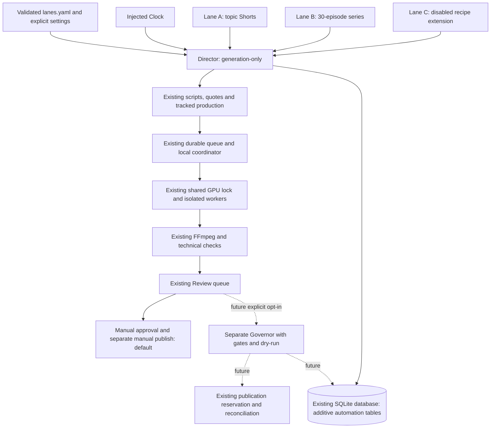

# Automation layer — Phase 1 foundation

Scope: root `AGENTS_AUTOMATION.md`, dated implementation 2026-11-06. This is an
additive layer on the existing single-host application, not a replacement workflow.
Phase 1 is complete. Phase 2 is committed as 7f0c1d9. Phase 3 generation/queue/UI
code is tested with mocked inference; its private five-Short hardware pilot is
pending. See PROGRESS.md for current measured acceptance and phase boundaries.

## Existing implementation and reuse boundaries

| Capability | Actual existing code | Later automation integration |
|---|---|---|
| Topic signals | `app/agents/trend_agent.py`, `youtube_service.py`, `ranking_service.py`, `storage_service.py` | Wrap discovery/ranking; never download third-party trend videos |
| Research | `research_service.py`, `research_dossiers.py` | GDELT links and source bundles; automatic bundles are unreviewed and do not become human-reviewed dossiers |
| Planning | `content_agent.py`, `script_generation_service.py`, `cinematic_screenplay.py`, `GenerationConfig`, `ProductionPlan`, `LongContentPlan` | Local Ollama defaults; chapter planning at most 180s per chapter; existing quote/consent paths for any future paid planning |
| Workflow and jobs | `content_workflow.py`, `job_service.py`, `cloud_video_service.py`, `cloud_video_storage.py` | Reuse tracked, preplanned production paths; `JobService.create_job` rejects direct moving-provider jobs, so do not point automated moving footage at the legacy illustrated endpoint |
| Cinematic production | `local_cinematic_service.py`, `local_production_runner.py`, local workers/coordinator | Existing UUIDs, isolated processes, shared GPU lock, memory reserve/allocator caps, deadlines and safe status refresh |
| Continuity | `cinematic_cast_service.py`, `cinematic_continuity.py`, `cinematic_adapter_service.py` | Owner-approved immutable cast per series, scene-start images and selected-tail dependencies; human checks remain until a later explicit Governor integration |
| Speech and assembly | Piper profiles, `character_dialogue_audio.py`, `speech_analysis.py`, `cloud_video_renderer.py` | Existing CPU narration/Whisper, FFmpeg, WER and real technical checks; forced alignment is limited to 30s audio segments |
| Durable work | `work_queue.py`, `application_worker.py` | Reuse single-host SQLite queue; no second Redis/SQLite queue for generation; stale running work is interrupted, not retried |
| Review and publishing | `routes.py`, `publishing_service.py`, `publishing_storage.py`, YouTube/Facebook publishers | Existing generation/review/publish privilege separation, review transitions, reservation and reconciliation; no Director publisher credential |
| Analytics | `collect_analytics.py`, `feedback_service.py`, analytics storage/adapters | Future feedback weighting, with unavailable metrics remaining unknown |
| Scheduling/supervision | `scheduler.py`, `scheduler_service.py`, `deploy/systemd`, `scripts/install_services.py` | Future jobs in the single existing APScheduler process; templates render only unless owner installs them |
| UI | React `App.jsx` and component tests; retained Streamlit pages | Future additive sidebar page with existing admin session/CSRF/style system; no UI edits in Phase 1 |

Names without a path prefix in this table are under `app/services/`, except the
root entry points and the `app/workflows/` / `app/models/` modules named above.

## Target flow and original foundation boundary

**At Phase 1 delivery:** configuration, Clock, schema/storage, events, idempotency,
Lane protocol, inert Director and offline inspection. Arrows into production,
queues, review, Governor, scheduler, APIs and UI are future integration, not working
automation. Importing the new package performs no I/O. Constructing Director does
not initialize SQLite; `run_day` always raises `NotImplementedError` in Phase 1.

`plan_day` is a pure recipe-interface preview. With no concrete recipes registered,
enabled lanes return `not_implemented`; globally disabled automation returns
`automation_disabled`. It is **not** the topic `plan-preview` promised in Phase 2.

## Lane and configuration contracts

`app/automation/lanes/Lane` defines `plan_day`, `produce`, `publishable`, `describe`.
The explicit registry maps a YAML `kind` to a trusted implementation. Lane C ships
as a disabled `custom` config and needs only an implementation/recipe registration
later; YAML cannot import arbitrary Python. Director never calls approval/publish.

`config/lanes.yaml` uses existing PyYAML and Pydantic dependencies. Strict schemas
reject unknown keys, duplicate keys, unsafe YAML tags/anchors/aliases, files over
128 KiB, invalid timezone/time values, conflicting quotas/slots, unsupported model
choices and invalid model/reference/voice combinations. Local Ollama and local
cinematic are the only accepted provider choices at this stage. There is no paid
automation execution path to accidentally enable before Phase 6 consent exists.

Defaults: five category-balanced Shorts per day; 30-day serialized story with
300–600s episodes; manual approval; image-conditioned connected LTX for series;
manual cast approval; Lane C disabled; Director/Governor globally disabled;
Governor dry-run true; provider budget zero. Optional future auto flags are parsed
but have no runtime implementation. Historical GPU rates are explicitly **seeds**,
not newly measured or trusted capacity guarantees.

The loader is explicit, not added to current FastAPI startup. Future automation
entry points must call it before opening storage/starting work and fail on invalid
configuration. Existing application startup and endpoints retain their behavior.
No `.env` or credential file is read by the loader or offline inspection command.

`Clock.now()` returns an aware instant. Persistent timestamps are UTC ISO-8601 with
microseconds. Plan dates are calculated in the configured IANA timezone; repeated
DST hours share the same date and unique plan-slot key.

## Additive storage

`AutomationStorage(db_path, clock=...)` follows existing storage initialization and
connection patterns, explicitly requiring a database path. All statements run under
one `BEGIN IMMEDIATE` transaction; repeated initialization adds no rows and changes
no legacy table/column/row, journal setting or `PRAGMA user_version`. Foreign keys
are connection-local. No migration runs from imports or the existing server.

| Table | Durable role / key |
|---|---|
| `trend_signals` | Raw signal metadata; unique `(source,external_id,collected_at)` |
| `topic_candidates` | Cluster/rank/category, contributing signal IDs, cooldown state |
| `daily_plans` | Topic/job/recipe/publish-slot linkage; unique `(plan_date,lane,slot)` |
| `series` | 30-day bible/hash, cast IDs, lifecycle and running story-state JSON |
| `series_episodes` | Outline/script/job/state/summary/timing; unique `(series_id,ep_no)` |
| `lane_settings` | Explicit runtime enabled/approval-mode overrides; not yet applied |
| `automation_events` | Actor/action/subject/detail/time audit, append-only triggers |
| `standing_authorizations` | Owner/provider/expiry/caps/accounting shape only; no spending methods |
| `governor_state` | Global kill and platform pause/failure state; no Governor yet |
| `automation_idempotency` | Supplemental request fingerprint/claim/result ledger; not a worker queue |

Every table has `created_at` and `updated_at`; append-only events retain the same
timestamp. Money columns use decimal text, not floating-point dollars. Atomic cap
reservation/consumption and authorization APIs are deliberately Phase 6 work.
Existing job/plan/cast/publication identifiers are linked as text where those
services own validation; no cascades or changes to existing tables are introduced.

## Idempotency and uncertain outcomes

- Canonical JSON plus SHA256 fingerprints bind request settings; UUIDv5 domain IDs
  distinguish dates, lane slots and episode numbers without ambiguous concatenation.
- `reserve_slot` uses SQLite uniqueness and returns one winning reservation. A later
  different recipe at the same date/lane/slot is a conflict, not a new production.
- `claim` gives only the first caller an owner token. Exact duplicates return saved
  status/result, never permission to execute. Changed payloads fail loudly.
- `complete_claim` is token-bound and idempotent for an identical result. Uncertain
  claims cannot complete through this method; no timeout/reset/reclaim API exists.
- A crash after reserving work remains reserved/uncertain. No TTL expires permission
  to resubmit. Future recovery must reconcile external IDs/billing before any new
  owner-authorized attempt. This ledger alone does not guarantee exactly-once remote
  effects; dispatchers must respect the submission boundary and existing quotes.
- Publishing stays uniquely reserved by existing `(job_id,platform)` storage.
  Automation does not create a second publication ledger or bypass dry-run defaults.

## Verification and extension sequence

See [PROGRESS.md](PROGRESS.md) for actual baseline/final counts and migration-copy
results; [DECISIONS.md](DECISIONS.md) records the scope and tradeoffs. The migration
checker opens the source SQLite database read-only, uses SQLite online backup
(including committed WAL content), retains an unmigrated backup, migrates a separate
working copy three times, compares all original rows/schema and runs integrity
checks. It never upgrades the source.

Phase 2 adds fixture-backed trend adapters and selection, Phase 3 Shorts/production
and GPU forecasting, Phases 4–5 story planning/production, Phase 6 Governor/consent/
scheduler/analytics, Phase 7 operations/soak/stretches. No later-phase work is claimed
complete here. Real hardware and current platform/account behavior remain unmeasured
by this foundation; no GPU or platform benchmark was run.

## Phase 2–3 integration update

TrendCollector wraps existing discovery/research; TopicSelector reads snapshots and
history without network or schema writes. New authenticated automation routes are
registered in the existing server. Reads do not construct mutating storage.

ShortsService atomically freezes a day/slots/topics/recipes/backups and one durable
queue intent. The application worker adds a generation-only automation handler.
Each original local script is stored by ScriptGenerationService, then its zero-cost
video quote is consumed by CloudVideoService. Existing ContentWorkflow skips
discovery/planning and submits the authorized local batch. The existing one-batch
guard is retained; day slots run serially, never competing model loads. Ollama
requests use the existing cinematic GPU lock and explicit unload acknowledgment.

New tables automation_day_runs, automation_slot_attempts, automation_gpu_measurements
and automation_short_receipts are additive. New mutating entry points back up an
existing pre-upgrade DB before initializing missing automation tables. Reports and
validation artifacts are private; GPU seeds and measured runs are distinct.

The Automation page reuses existing components/styles and human quality controls.
Technical output waits at awaiting_quality_review; no automatic human confirmations,
approval or publication. Director run_day requires enabled configuration and an
explicit generation producer. Scheduler and Governor wiring remain Phase 6 work.

## Phase 4 planning update

SeriesService creates one actor-bound UUID intent in the existing durable queue.
A worker uses the shared LocalJSONPlanner (no cloud provider), persists submitting
and received receipts, validates premises/bible and six ordered five-day chunks,
then leaves the series awaiting_cast. New private receipt/request tables are
additive to the existing series/series_episodes entities. No episode jobs are made.

The React Automation series view reads durable status, shows 30 hooks, supports
full-outline validated optimistic edits, and explicitly binds an existing verified
cast package. Bible hash and actor IDs/name/appearance/wardrobe/voice must match;
a human-confirmed session/CSRF request alone can activate it. No auto-cast escape
hatch exists. One active series per lane; episode production locks editing.

Deterministic validation enforces structural continuity and thread timing; semantic
story quality still requires human inspection. No LLM judge or video performance
claim is made. See SERIES.md and PROGRESS.md for operations and measured evidence.
